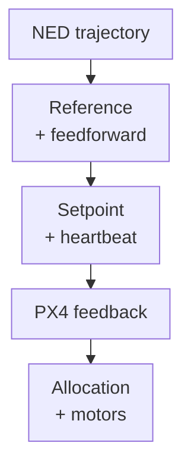

<span id="offboard-position-control"></span>

# Offboard Position

This node sends a trajectory reference to PX4. PX4 calculates position feedback and all lower control stages. The external node generates the requested motion and handles the mode sequence; it does not replace PX4's translational feedback with the SE(3) law.



## Reference and messages

`TrajectorySetpoint` carries NED position [m], velocity [m/s], acceleration [m/s²], jerk [m/s³], yaw [rad], and yaw rate [rad/s]. Position is the active feedback level (`OffboardControlMode.position=true`); velocity and acceleration provide translational feedforward. Jerk is carried in the message, but the pinned PX4 position controller does not consume it. Both messages share each publication timestamp. See [publication.cpp](https://github.com/ANCL/px4-dev-toolkit/blob/main/ros2/src/offboard_controllers/src/offboard_position/publication.cpp).

The node runs at **20 Hz**. During prestream, the trajectory stays at time zero at the configured absolute NED start position, independent of the measured vehicle position; the trajectory clock starts when PX4 confirms Offboard. Desired yaw comes from trajectory configuration. Read [Trajectories](trajectories.md) for absolute NED segment definitions.

## Run

Prepare SITL and verify valid local position/status. This controller never requests arming; the pilot or SITL staging helper must arm first. For an airborne comparison, first prepare the aircraft using the [Offboard Staging](offboard-staging.md). A `hover` trajectory holds its configured absolute NED position; it is not an automatic climb from the ground.

In a **separate repository-root shell**, after checking the intended simulated vehicle and ensuring no other Offboard controller is running:

```bash
source ros2/runtime_env.sh
ros2 launch offboard_controllers offboard_position.launch.py \
  trajectory:=line_tracking
```

## Activation

`offboard_trigger:=automatic` (default) requests Offboard after readiness and
prestreaming. `offboard_trigger:=external` never arms or requests Offboard:
it waits for the pilot's RC/joystick mode change and PX4-confirmed Offboard.
Neither setting arms the aircraft: prepare and arm through the pilot or SITL
staging first. Both start the trajectory clock on confirmed entry. Automatic
mode requests Position at trajectory completion; external mode holds the final
setpoint and heartbeat until the pilot selects Position mode. For `hover`, the reference holds the configured fixed NED start position and heading for 10 seconds.

For an external-trigger example:

```bash
ros2 launch offboard_controllers offboard_position.launch.py \
  trajectory:=hover offboard_trigger:=external
```

On physical hardware, validate the external mode switch, estimator, Offboard
loss response and pilot Position-mode recovery without propellers before flight.

## Readiness, timing, and return

The [lifecycle](https://github.com/ANCL/px4-dev-toolkit/blob/main/ros2/src/offboard_controllers/src/offboard_position/lifecycle.cpp) waits for status and valid position, then waits for the aircraft to be armed. It sends **30 heartbeat/setpoint samples** (about 1.5 s at 20 Hz), requests Offboard only in automatic mode, and waits for `nav_state` confirmation.

At trajectory completion, automatic mode requests Position while continuing a valid stream; external mode holds the final reference and waits for a pilot-selected Position mode without a fixed handback deadline. Only confirmed Position-mode return completes the experiment. Unexpected disarm, invalid position, or another unrequested mode transition fails the experiment. Initial state readiness can time out after 20 s; automatic takeover and return waits after 5 s. Waiting for pilot arming and external mode selection has no short timeout. These deadlines use a steady clock; trajectory time uses the ROS clock.

Failure/interrupt exit does not issue a guaranteed landing command. After return, land and disarm the simulated vehicle through the prepared flight controls before stopping SITL.

## Configuration source

In a toolkit checkout, the launch reads the working source
`config/trajectories.yaml` at each
controller startup, not the installed copy. A YAML-only edit needs a fresh
controller process, **not** a ROS rebuild. The launch logs the selected path.
For a standalone ROS install without the toolkit checkout, packaged YAML is
used and explicitly reported.

## Recording and interpretation

Add `record:=true` for a standalone bag under `bags/offboard_position/`. The `recording_output` argument lets a sequence write that bag inside its study directory. Compare measured position to the desired trajectory and inspect PX4 mode transitions before interpreting error. A downstream attitude/rate setpoint is calculated by PX4, so it should not be described as the external controller's law. Continue with [SE(3) control](se3.md) to move the command level farther down the stack.
