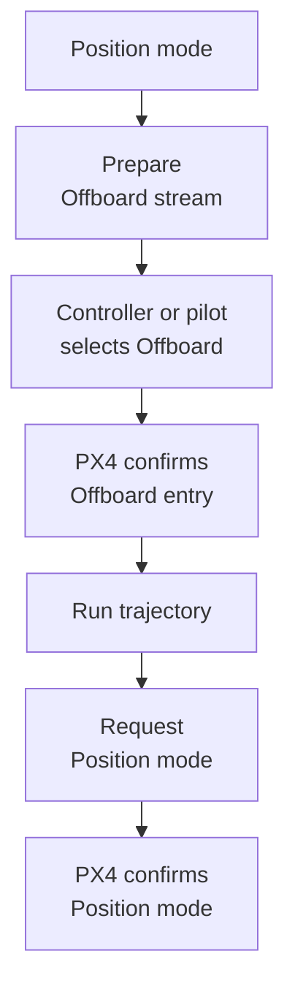

# Offboard Staging

The staging helper prepares a **SITL aircraft** for an independent Offboard
controller. Unlike the [Position Mode](position-mode.md) reference flight,
it does not land or disarm after reaching its hold state. It also does not
request Offboard mode itself.

## Prepare the aircraft

Use a prepared SITL environment with `GCS=mavproxy`, valid PX4 state,
no competing controller, and an initially landed/disarmed aircraft.
In a **repository-root shell**, run:

```bash
source ros2/runtime_env.sh
ros2 launch px4_position_mode offboard_takeoff_handoff.launch.py
```

The [staging helper](https://github.com/ANCL/px4-dev-toolkit/tree/main/ros2/src/px4_position_mode/src/offboard_staging)
supplies minimum-throttle input, selects Position mode, arms, climbs to
the configured staging altitude, and centers the virtual joystick to hold.
It then waits for another controller to enter Offboard and exits after
confirmed takeover. Configuration lives in
[offboard.yaml](https://github.com/ANCL/px4-dev-toolkit/blob/main/ros2/src/px4_position_mode/config/offboard.yaml).

**Start the independent controller only after staging reaches its hold phase.**
Do not run the reference Position-mode flight and the staging helper
concurrently.

## Offboard transition

**Offboard** means PX4 accepts an external controller's chosen command type.
A ROS `OffboardControlMode` heartbeat identifies the active command level.
With automatic activation, the controller requests Offboard. With external
activation, the pilot or another source selects it. Both paths confirm
`VehicleStatus.nav_state`; a command acknowledgement alone is insufficient.



[Offboard Position](offboard-position.md) streams a heartbeat and actual
trajectory setpoints before takeover; only automatic activation requests Offboard.
[SE(3) Control](se3.md#when-the-controller-starts-and-stops) warms up its
heartbeat and diagnostic trajectory reference, then begins the selected
control output after confirmed Offboard entry. The two controllers differ
in their failure and return behavior; consult the relevant controller page.

## After handoff

The staging helper exits when the independent controller enters Offboard.
A confirmed return to Position mode ends the controller experiment, but
**does not necessarily land or disarm the aircraft**. Use the
[SITL landing and reset procedure](../environments/sitl.md#land-and-reset-the-simulated-vehicle)
before starting another run or stopping the environment.

Interrupting an active controller can remove its command stream and invoke
PX4's configured failsafe instead of a controlled return. Check actual
mode, position, and arming state before proceeding.
