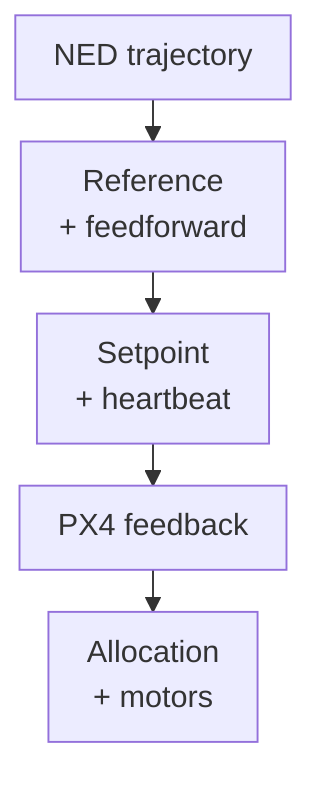

<span id="offboard-position-control"></span>

# Offboard Position

This ROS 2 node sends trajectory position and feedforward setpoints to PX4, which retains position feedback and all lower control loops.



## Reference and messages

`TrajectorySetpoint` carries NED position [m], velocity [m/s], acceleration [m/s²], jerk [m/s³], yaw [rad], and yaw rate [rad/s]. Position is the active feedback level (`OffboardControlMode.position=true`); velocity and acceleration provide translational feedforward. Jerk is carried in the message, but the pinned PX4 position controller does not consume it. Both messages share each publication timestamp. See [publication.cpp](https://github.com/ANCL/px4-dev-toolkit/blob/main/ros2/src/offboard_controllers/src/offboard_position/publication.cpp).

The node runs at **20 Hz**. During prestream, the trajectory stays at time zero at the configured absolute NED start position, independent of the measured vehicle position; the trajectory clock starts when PX4 confirms Offboard. Desired yaw comes from trajectory configuration. Read [Trajectories](../../experiments/trajectories.md) for absolute NED segment definitions.

## Run

Follow [Offboard control](../../operations/offboard.md) to prepare an airborne vehicle in Position mode near the selected trajectory's absolute NED start.

In a **separate Ubuntu repository-root shell**, after checking the intended simulated vehicle and ensuring no other Offboard controller is running:

```bash
source ros2/runtime_env.sh
ros2 launch offboard_controllers offboard_position.launch.py \
  trajectory:=line_x
```

## Activation

`offboard_trigger:=automatic` requests Offboard after prestream; `external` waits for the pilot's Offboard selection. Both start the trajectory on PX4-confirmed entry. At completion, automatic mode requests Position; external mode continues tracking the final reference until pilot handback. Neither trigger arms the vehicle.

For an external-trigger example:

```bash
ros2 launch offboard_controllers offboard_position.launch.py \
  trajectory:=hover offboard_trigger:=external
```

On physical hardware, validate the external mode switch, estimator, Offboard
loss response and pilot Position-mode recovery without propellers before flight.

## Readiness, timing, and return

The [lifecycle](https://github.com/ANCL/px4-dev-toolkit/blob/main/ros2/src/offboard_controllers/src/offboard_position/lifecycle.cpp) waits for status and finite position with valid XY/Z flags, then waits for the aircraft to be armed. `hover` additionally requires `heading_good_for_control` and finite heading, although its target yaw still comes from the trajectory. These checks do not check sample age. It sends **30 heartbeat/setpoint samples** (about 1.5 s at 20 Hz), requests Offboard only in automatic mode, and waits for `nav_state` confirmation.

At trajectory completion, automatic mode sends one Position request while continuing a valid stream; external mode holds the final reference and waits for a pilot-selected Position mode without a fixed handback deadline. Only confirmed Position-mode return completes the experiment. Unexpected disarm or invalid position after readiness, leaving Offboard during tracking, or handback to a mode other than Position fails the experiment. Initial state readiness can time out after 20 s; automatic takeover and return waits after 5 s. Waiting for pilot arming and external mode selection has no short timeout. These deadlines use a steady clock; trajectory time uses the ROS clock.

On failure or interruption, recover through pilot control. After confirmed Position return, land and disarm before stopping SITL.

## Configuration source

In a toolkit checkout, the launch reads the working source
`config/trajectories.yaml` at each
controller startup, not the installed copy. A YAML-only edit needs a fresh
controller process, **not** a ROS rebuild. The launch logs the selected path.
For a standalone ROS install without the toolkit checkout, packaged YAML is
used and explicitly reported.

## Recording and interpretation

Add `record:=true` for `bags/offboard_position/`; `recording_output` selects a study directory. Compare the reference and measured position, mode transitions, and PX4-generated attitude/rate setpoints. For lower-level handoffs, see [Offboard SE3](se3/index.md).
