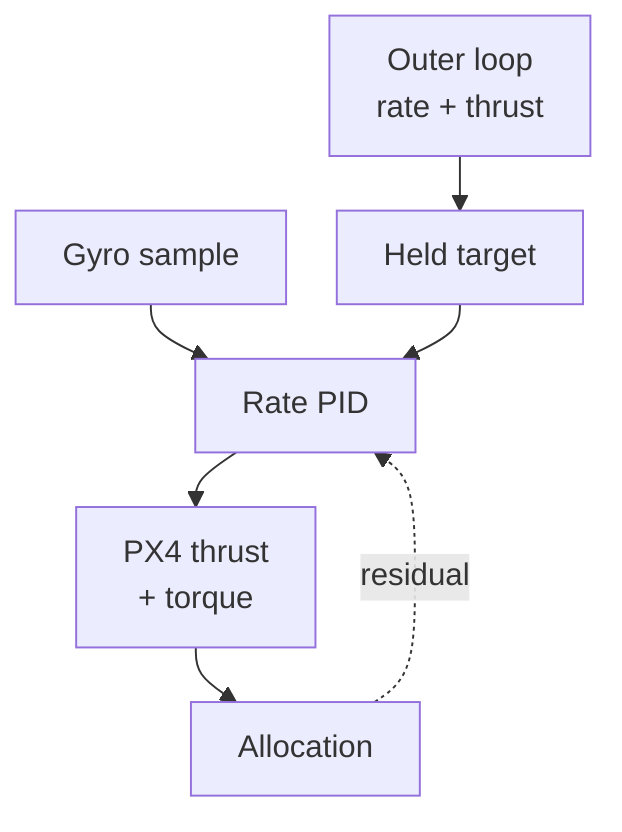

<span id="px4-rate-controller"></span>

# PX4 Rate PID

The toolkit's outer geometric attitude controller holds a body-rate command and collective thrust. A reproduced **pinned PX4 angular-rate loop** then calculates normalized torque on each gyro sample. PX4 receives the wrench and performs control allocation.



## Two control clocks

The outer loop computes

$$
\Omega_{\mathrm{sp}}=R^\top R_d\Omega_d-K_{\mathrm{att}}e_R
$$

and the common hover-scaled collective $u_T$. It updates at `control_rate_hz` (100 Hz by default). Its analytic attitude rate uses desired jerk and yaw rate, without snap-based angular acceleration feedforward.

The **inner loop** runs from `VehicleAngularVelocity.timestamp_sample`, not the outer timer. It consumes `xyz` [FRD rad/s] and `xyz_derivative` [FRD rad/s²]. For successive microsecond samples:

$$
\begin{aligned}
\Delta t&=\operatorname{clip}_{[0.000125,\,0.02]} \\
&\quad\left(10^{-6}(t_{\mathrm{sample},k}-t_{\mathrm{sample},k-1})\right).
\end{aligned}
$$

Inactive callbacks still advance the last sample timestamp. The loop publishes only when Offboard is active, a finite held target is available, and the required state is ready. Both outgoing messages retain the incoming `timestamp_sample` alongside their publication timestamp. See [se3/node.cpp](https://github.com/ANCL/px4-dev-toolkit/blob/main/ros2/src/offboard_controllers/src/se3/node.cpp).

## P/I/D and feedforward

For axis $i$, let $e_i=\Omega_{\mathrm{sp},i}-\Omega_i$ (desired minus measured, unlike the geometric $e_\Omega$ sign). Effective gains are

$$
\begin{aligned}
P_i&=K_i p_i \\
I_i&=K_i i_i \\
D_i&=K_i d_i.
\end{aligned}
$$

The parameter vectors are `px4_rate_p`, `_i`, `_d`, and `_k`. Feedforward `px4_rate_ff` is **not multiplied by $K_i$**. With integrator state $\eta_{i,k}$ at the beginning of this sample:

$$
\begin{aligned}
\tau_{i,k}^{\mathrm{raw}}&=P_i e_i+\eta_{i,k} \\
&\quad-D_i\dot\Omega_{\mathrm{meas},i}+F_i\Omega_{\mathrm{sp},i}.
\end{aligned}
$$

Torque is normalized. $P$ and $F$ map rad/s to normalized torque, $D$ maps rad/s², and $I$ maps the time integral of rate error. D feedback uses the supplied **measured angular acceleration**, not a finite difference of rate error or the analytic desired acceleration used by geometric laws.

## Integrator order and anti-windup

The output above uses the **old** integrator. After calculating it, the code updates the integrator only when neither `landed` nor `maybe_landed` is true. Before an active update, disarmed or non-rotary-wing state resets the integrator.

`ControlAllocatorStatus.unallocated_torque` sets positive/negative saturation flags when `torque_setpoint_achieved` is false. Positive residual gates $e_i$ to $\min(e_i,0)$; negative residual gates it to $\max(e_i,0)$. An error that would unwind saturation still integrates. The latest allocator flags persist until the next status update.

Using the gated error $\bar e_i$:

$$
\begin{aligned}
\gamma_i&=\max\left(0,1-(\bar e_i/e_s)^2\right) \\
e_s&=400\pi/180\ \mathrm{rad/s}
\end{aligned}
$$

$$
\eta_{i,k+1}=\operatorname{clip}_{[-L_i,L_i]}
\left(\eta_{i,k}+\gamma_i I_i\bar e_i\Delta t\right).
$$

$L_i$ is `px4_rate_integrator_limit`. Non-finite candidates are discarded. Large errors reduce integration smoothly; landed state holds it rather than adding another reset rule. Diagnostics distinguish integral feedback used in this output from the integrator state after the update.

## Yaw-torque filter

Roll/pitch pass through the raw torque. Yaw uses a first-order filter with cutoff $f_c$:

$$
\begin{aligned}
T_f&=1/(2\pi f_c) \\
\beta&=\Delta t/(T_f+\Delta t)
\end{aligned}
$$

$$
\tau_{z,k}=\tau_{z,k-1}+\beta(\tau_{z,k}^{\mathrm{raw}}-\tau_{z,k-1}).
$$

The configured cutoff is 2 Hz. A zero cutoff sets $T_f=0$, giving pass-through ($\beta=1$). This filter state is separate from the integrator and is not reset by `reset_integral()`.

## Messages and supported scope

Only `OffboardControlMode.thrust_and_torque` is enabled. `VehicleThrustSetpoint.xyz=(0,0,-u_T)` uses the mass/hover-thrust projection; `VehicleTorqueSetpoint.xyz` contains normalized torque with filtered yaw. The runtime uses finite-or-zero torque publication for invalid numerical components; readiness for this path records receipt of gyro samples rather than requiring every sample to be finite.

The reproduction targets **ANCL/PX4-Autopilot commit `9af25b30f067c36269e94a96797be7943dd4f8e1`**, specifically [rate_control.cpp](https://github.com/ANCL/PX4-Autopilot/blob/9af25b30f067c36269e94a96797be7943dd4f8e1/src/lib/rate_control/rate_control.cpp), [MulticopterRateControl.cpp](https://github.com/ANCL/PX4-Autopilot/blob/9af25b30f067c36269e94a96797be7943dd4f8e1/src/modules/mc_rate_control/MulticopterRateControl.cpp), and [AlphaFilter.hpp](https://github.com/ANCL/PX4-Autopilot/blob/9af25b30f067c36269e94a96797be7943dd4f8e1/src/lib/mathlib/math/filter/AlphaFilter.hpp).

The toolkit requires `px4_rate_battery_scale_enabled=false`, matching the verified baseline `MC_BAT_SCALE_EN=0`. Enabled battery scaling is rejected. There is no additional torque clamp at publication for this disabled-scaling path. This is a specific calculation reproduction, not a promise of identical scheduling, sensors, or future PX4 behavior.

## Run and interpret

Mass and curated hover thrust, valid position/velocity and attitude, and incoming gyro data are required. Use the shared [lifecycle precautions](index.md#when-the-controller-starts-and-stops). In a **separate repository-root shell**, with a matching airborne SITL vehicle and no competing controller:

```bash
source ros2/runtime_env.sh
ros2 launch offboard_controllers se3.launch.py \
  vehicle:=gz_f450 trajectory:=full_excitation handoff:=thrust_and_torque \
  direct_controller:=px4_rate publish_diagnostics:=true record:=true
```

Inspect P/I/D/feedforward contributions, old/new integrator state, raw versus filtered yaw torque, sample intervals, allocator residuals, and motors. Increasing gains can raise requested torque without increasing available torque. Transport latency and dropped messages can change the experiment even with identical formulas.

The toolkit calculation is [px4/rate_controller.cpp](https://github.com/ANCL/px4-dev-toolkit/blob/main/ros2/src/offboard_controllers/src/px4/rate_controller.cpp); field/timing publication is [runtime/publication.cpp](https://github.com/ANCL/px4-dev-toolkit/blob/main/ros2/src/offboard_controllers/src/se3/runtime/publication.cpp).
