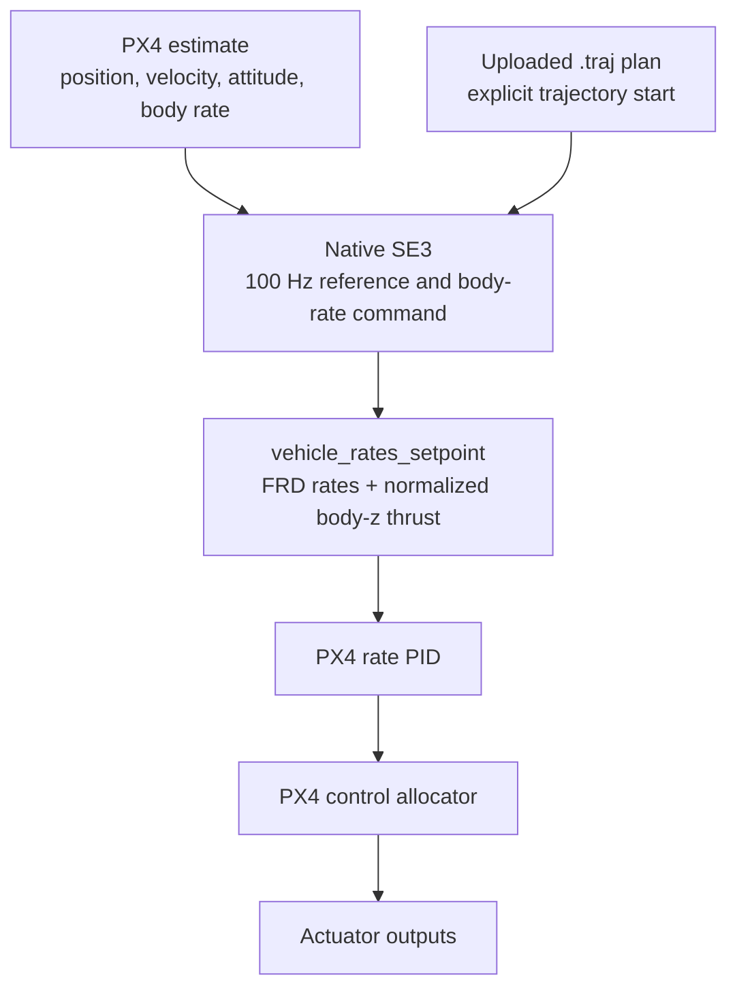

# Onboard SE3

Onboard SE3 is a native PX4 firmware mode for an already-flying, underactuated multicopter. It tracks a local NED position/heading reference and publishes **body-rate and normalized collective-thrust setpoints** internally. PX4 retains the rate controller, control allocator, actuator outputs, Commander mode management, and configured failsafes.

Implementation: `ANCL/PX4-Autopilot` revision `5dd32eb1e7ab8b79b8ece462ce5f22cd75272c56`. See [Onboard control](../operations/onboard.md) for operation, [Trajectories](trajectories.md) for reference definitions, and [Geometric control](../mathematics/geometric-control.md) for the derivation.

## Control path and scheduling

[`Se3Runtime`](https://github.com/ANCL/PX4-Autopilot/blob/5dd32eb1e7ab8b79b8ece462ce5f22cd75272c56/src/modules/se3_control/Runtime.cpp) schedules a reference/control update every **10 ms** on PX4's `rate_ctrl` work queue. This is a nominal 100 Hz update schedule, not a measured timing guarantee. PX4's downstream rate controller runs from angular-velocity callbacks; its update rate is not set by SE3's 100 Hz schedule.

The mode enables only rate control and allocation in its Commander control configuration. Native position and attitude feedback controllers do not run its outer loop. `FlightModeManager` disables its flight tasks for registered external modes, so the native module owns the active trajectory reference publication.

SE3 publishes `vehicle_rates_setpoint` only while its own registered mode is selected, the required control flags match, and state/configuration are valid. It also publishes `vehicle_attitude_setpoint` as an observation of its exact desired rotation and thrust; that publication does not enable PX4's attitude controller.

## The active control law

Positions and velocities use PX4 local **NED**. Attitude \(R\) maps body **FRD** into NED; measured angular velocity \(\Omega\) is in current-body FRD. With \(e_x=x-x_d\), \(e_v=v-v_d\), and \(e_3=[0,0,1]^T\), the native translation calculation is

\[
a_c=a_d-\bar k_x e_x-\bar k_v e_v,
\qquad
A=m(a_c-g e_3).
\]

The parameters `SE3_KX` and `SE3_KV` are \(\bar k_x=k_x/m\) and \(\bar k_v=k_v/m\). The runtime multiplies them by mass before passing physical gains into the pure controller. Thus \(A\) is a force in newtons, not a normalized PX4 command. Hover produces an upward force, along negative NED z.

[`Controller::compute_geometry()`](https://github.com/ANCL/PX4-Autopilot/blob/5dd32eb1e7ab8b79b8ece462ce5f22cd75272c56/src/modules/se3_control/Controller.cpp) computes analytic first/second desired-force derivatives using trajectory jerk/snap and a nominal rigid-body model. It uses measured attitude and body rates to derive body-axis motion; it does not finite-difference measured acceleration or gyro samples.

The desired body z direction is \(b_{3d}=-A/\lVert A\rVert\). The heading direction \([\cos\psi_d,\sin\psi_d,0]^T\) completes the desired orthonormal rotation \(R_d\). Analytic basis derivatives give desired-body rates \(\Omega_d\) and accelerations \(\dot\Omega_d\). Nearly zero force or a heading/thrust alignment that cannot define the basis is rejected.

The active rotational mapping in [`AttitudeLaws::body_rate()`](https://github.com/ANCL/PX4-Autopilot/blob/5dd32eb1e7ab8b79b8ece462ce5f22cd75272c56/src/modules/se3_control/AttitudeLaws.cpp) is

\[
e_R=\frac12\left(R_d^T R-R^T R_d\right)^\vee,
\qquad
\Omega_{\mathrm{sp}}=R^T R_d\Omega_d-K_R e_R,
\]

where \(K_R\) is diagonal, with `SE3_KRX`, `SE3_KRY`, and `SE3_KRZ` on its diagonal. Each rate component is clamped independently to \(\pm\texttt{SE3\_RATE\_MAX}\) rad/s. The geometric helper also computes desired angular acceleration, but this body-rate law has no direct angular-acceleration feedforward term.

Collective thrust uses the current body-axis projection

\[
f=-A\cdot(Re_3),
\qquad
u_T=\operatorname{clip}\!\left(
  \texttt{MPC\_THR\_HOVER}\frac{f}{mg},\,0,\,1
\right),
\qquad
\texttt{thrust\_body}=[0,0,-u_T].
\]

A nonfinite or nonpositive \(f\) rejects the calculation. The negative body-z sign matches conventional multicopter thrust in FRD. The hover-thrust parameter provides the force-to-normalized-command scale; this native path does not use the ROS vehicle YAML's thrust-conversion implementation.

The runtime calls `body_rate()` and publishes rate setpoints; PX4 rate PID computes downstream torque. The physical-moment law in [Geometric control](../mathematics/geometric-control.md) is not the native mode's output interface.

## Registration and reference lifecycle

SITL `rcS` starts `se3_control` after Commander. Starting the module while disarmed registers the **SE3** mode and arming/health check; Commander assigns its mode ID dynamically. Registration does not select the mode.

| Event | Native behavior |
|---|---|
| `se3_control select` | Publishes a request for its registered navigation state; Commander can reject it. |
| Confirmed mode entry with valid state | Captures measured local position and heading, zeros reference derivatives, and holds. |
| `trajectory select <name>` | Loads/validates and stages a plan; does not change mode or start movement. |
| `trajectory start <name>` while SE3 is active and holding | Loads/validates that file, queues an explicit start request, and the SE3 work queue starts its clock. |
| Trajectory completion | Holds the exact final reference; SE3 remains the active mode. |
| `se3_control hold` while active | Queues capture of the current measured pose and cancels execution; SE3 remains active. |
| Selection of another mode | Stops SE3 setpoint publication and execution; a later SE3 entry captures a new hold pose. |

A plan starts through `trajectory start <name>` while SE3 is active and holding. Starting another plan while running is rejected; first request `se3_control hold` and confirm holding state.

Uploaded plans use **absolute local NED** coordinates. `trajectory start` does not align the plan or check proximity to its start; verify the aircraft's pose before starting. Completion holds the plan's final pose; `se3_control hold` captures the measured pose.

[`trajectory`](https://github.com/ANCL/PX4-Autopilot/blob/5dd32eb1e7ab8b79b8ece462ce5f22cd75272c56/src/modules/trajectory_manager/trajectory.cpp) is the PX4 shell interface to the catalog. It is distinct from the Ubuntu-side `./tools/trajectory` compiler/uploader. The firmware loader verifies the V2 format, finite values, CRC32, 1–32 segments, valid segment parameters, and a return to the stored starting position/heading within its tolerances. That file-closure validation is unrelated to the aircraft's measured start pose.

## Parameters and configuration ownership

[Native SE3 parameters](https://github.com/ANCL/PX4-Autopilot/blob/5dd32eb1e7ab8b79b8ece462ce5f22cd75272c56/src/modules/se3_control/module.yaml) default to disabled with zero mass/gains. Load a parameter profile explicitly before flight.

| Parameter | Meaning | Checked-in `gz_f450` profile |
|---|---|---|
| `SE3_ENABLE` | Permit readiness for native SE3 | `1` |
| `SE3_MASS` | Vehicle mass, kg | `2.0736` |
| `SE3_KX` | Position gain divided by mass, s⁻² | `6.0` |
| `SE3_KV` | Velocity gain divided by mass, s⁻¹ | `5.0` |
| `SE3_KRX`, `SE3_KRY` | Roll/pitch attitude-to-rate gains, s⁻¹ | `6.5`, `6.5` |
| `SE3_KRZ` | Yaw attitude-to-rate gain, s⁻¹ | `2.8` |
| `SE3_RATE_MAX` | Per-axis requested-rate limit, rad/s | `3.0` |
| `MPC_THR_HOVER` | Existing PX4 normalized hover-thrust scale | Not set by this profile |

The native module reads PX4 parameters; editing `ros2/src/offboard_controllers/config/se3/controller.yaml` does not configure it. Native rate PID gains, allocation geometry, estimator settings, and actuator configuration remain PX4 responsibilities. Reference definitions live in shared `config/trajectories.yaml`; they reach firmware only after compilation and upload.

The only provided ready-to-load native controller profile is `gz_f450.parm`, guarded by `SYS_AUTOSTART=4022` in the loader. The F450 hardware file is a commented `.parm.example`, not validated tuning. Parameter loading prechecks parameter names/types, confirms disarmed state, and verifies acknowledgements; it is not a transaction that rolls back earlier writes after an error.

## Readiness and faults

Selection is for an **armed, airborne, non-VTOL rotary-wing aircraft**, with no active failsafe. The native health reply explicitly prevents arming in SE3. The runtime also requires received land-detection state, valid finite local position/velocity/heading, finite attitude and gyro state, configured positive finite gains/mass/rate limit, and `0 < MPC_THR_HOVER < 1`.

Local-position and attitude timestamps must be at most **200 ms** old; gyro timestamps at most **100 ms** old. Attitude quaternion squared norm must lie strictly between `0.9` and `1.1`. The runtime explicitly excludes autostart IDs `6010` and `6002`; this exclusion is not proof that every other aircraft configuration is supported.

Once active, changes to local XY, local z, or quaternion estimator reset counters latch a fault. Invalid/stale state, failed trajectory sampling, or a failed geometric calculation also stops setpoint publication and latches a fault. Recovery of a stale sample alone does not resume execution. Exit the mode and disarm before the latched fault is cleared. Commander consumes the health replies and retains mode/failsafe authority; do not interpret the runtime's readiness checks as an independently validated flight-safety system.

The module can only be stopped while disarmed. Returning to pilot control uses a mode change, not module shutdown.

## Monitoring and evidence

`se3_control status` reports its Commander/arming-check IDs, enabled/active/faulted flags, and holding/running/completed state. Check these together with PX4's actual mode and aircraft state. `trajectory status` describes the staged plan; it is not a flight-mode or execution-status display.

While active, the module publishes standard `trajectory_setpoint` position, velocity, acceleration, jerk, yaw, and yaw rate for observation/recording. The dedicated `se3_trajectory_status` uORB message adds run ID, plan CRC32, phase, elapsed time, snap, and heading acceleration. It is an onboard ULog signal and is **not** exported through the pinned DDS topic configuration. A ROS bag therefore cannot recover all native run metadata; see [Onboard flight logging](../workflows/onboard-logging.md).

Test coverage is recorded under [Validation scope](../reference/architecture.md#validation-scope).
