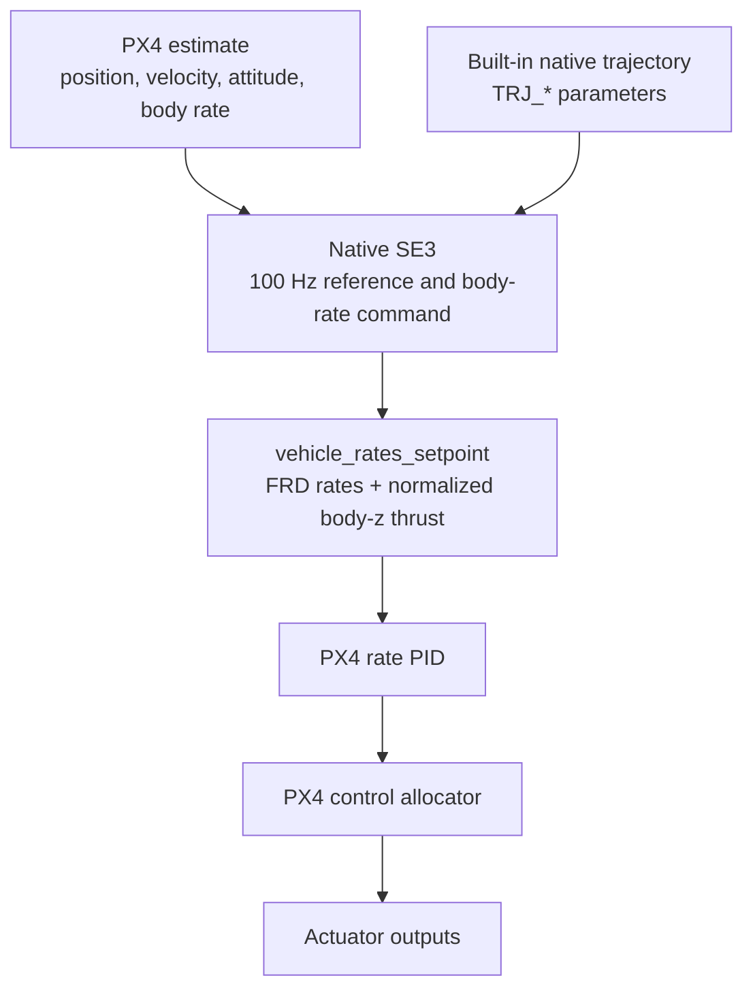

# Onboard SE3

Onboard SE3 is a native PX4 firmware mode for an already-flying, underactuated multicopter. It tracks a local NED position/heading reference with one geometric translation law and commands PX4 through one of three paths selected by `SE3_CTRL` at boot:

| `SE3_CTRL` | Path | SE3 command | Downstream |
|---|---|---|---|
| 0 | ATTITUDE_PX4 | geometric attitude + normalized thrust | PX4 attitude and rate controllers, native allocation |
| 1 (default) | RATE_PX4 | body rate + normalized thrust | PX4 rate controller, native allocation |
| 2 | PHYSICAL | SI Lee wrench at the gyro rate | physical allocation in `control_allocator` with the `CA_ROTOR*` effectiveness |

PX4 retains actuator outputs, Commander mode management, and configured failsafes in every path. The reference, trajectories, position integral, lifecycle and faults below are common to all paths; the command-path diagram and the body-rate law detail RATE_PX4. The [module README](https://github.com/ANCL/PX4-Autopilot/blob/lab/main/src/modules/se3_control/README.md) documents all three paths, the physical allocation and the integrals.

The installed PX4 revision is selected by [config/sources/px4.env](https://github.com/ANCL/px4-dev-toolkit/blob/main/config/sources/px4.env). The source links below follow the current `lab/main` firmware. See [Onboard control](../../operations/onboard.md) for operation, [Trajectories](../../experiments/trajectories.md) for reference definitions, and [Geometric control](../../mathematics/index.md) for the derivation.

## Control path and scheduling

RATE_PX4 (`SE3_CTRL = 1`) command path:



[`Se3Runtime`](https://github.com/ANCL/PX4-Autopilot/blob/lab/main/src/modules/se3_control/Runtime.cpp) schedules a reference/control update every **10 ms** on PX4's `rate_ctrl` work queue. This is a nominal 100 Hz update schedule, not a measured timing guarantee. PX4's downstream rate controller runs from angular-velocity callbacks; its update rate is not set by SE3's 100 Hz schedule. In ATTITUDE_PX4, SE3 instead publishes `vehicle_attitude_setpoint` at 100 Hz to `mc_att_control`; in PHYSICAL, a gyro-triggered inner loop publishes one `se3_wrench_setpoint` per gyro sample to `control_allocator`.

In RATE_PX4 the mode enables only rate control and allocation in its Commander control configuration; ATTITUDE_PX4 adds attitude control, and PHYSICAL enables only allocation. Native position and attitude feedback controllers do not run its outer loop. `FlightModeManager` disables its flight tasks for registered external modes, so the native module owns the active trajectory reference publication.

SE3 publishes its command (`vehicle_rates_setpoint` in RATE_PX4) only while its own registered mode is selected, the required control flags match, and state/configuration are valid. In RATE_PX4 it also publishes `vehicle_attitude_setpoint` as an observation of its exact desired rotation and thrust; that publication does not enable PX4's attitude controller.

## The active control law

Positions and velocities use PX4 local **NED**. Attitude \(R\) maps body
**FRD** into NED; angular velocity is expressed in body FRD. With
\(e_x=x-x_d\), \(e_v=v-v_d\) and \(e_3=[0,0,1]^T\), define the
**mass-normalized** gains \(\bar k_x=k_x/m\), \(\bar k_v=k_v/m\):

\[
a_c=a_d-\bar k_xe_x-\bar k_ve_v-\bar k_i\!\int \operatorname{sat}(e_x)\,dt,
\qquad B=a_c-ge_3=A/m.
\]

The position integral (\(\bar k_i=\) diag(`SE3_KIXY`, `SE3_KIXY`, `SE3_KIZ`))
removes steady position offsets in all three paths. The integrated error is
saturated at 0.5 m per axis; the integral acceleration is bounded to 1 m/s²
horizontally and 2 m/s² vertically. Integration is frozen while the
normalized command or the allocator saturates. The integral is reset on mode
entry and exit and on faults (including estimator resets), and is kept across
trajectory commands. The analytic force derivatives include the integral's
actual rate, so \(\Omega_d\) stays consistent with it.

The firmware computes the specific force \(B\) directly in m/s².
No vehicle mass is multiplied into or divided out of the geometric
reference. Its analytic derivatives come from jerk, snap and the nominal
rigid-body dynamics; estimator acceleration is not numerically differentiated.

The desired body z-axis is \(b_{3d}=-B/\lVert B\rVert\). The desired heading
completes the orthonormal rotation \(R_d\). RATE_PX4 geometric attitude feedback uses

\[
e_R=\tfrac12(R_d^TR-R^TR_d)^\vee,
\qquad
\Omega_{\mathrm{sp}}=R^TR_d\Omega_d-K_Re_R.
\]

`SE3_KRX`, `SE3_KRY`, and `SE3_KRZ` are the diagonal entries of \(K_R\).
The desired angular-rate feedforward \(\Omega_d\) is analytical. The rate
command is clamped per axis to `SE3_RATE_MAX` rad/s at publication.

For current body z-axis \(b_3=Re_3\), the collective acceleration and
PX4-normalized thrust (ATTITUDE_PX4 and RATE_PX4) are

\[
u=-B\cdot b_3,
\qquad
u_T=\operatorname{clip}\!\left(\texttt{MPC\_THR\_HOVER}\frac{u}{g},0,1\right),
\qquad \texttt{thrust\_body}=[0,0,-u_T].
\]

Nonpositive or nonfinite \(u\) is rejected. In RATE_PX4, PX4 runs the
downstream rate PID and control allocator. PHYSICAL instead commands the thrust
\(f=m\,u\) with `SE3_MASS` and a Lee moment in N·m at the gyro rate (module
README). It is separate from the **ROS Offboard `geometric_physical`**
controller; see the [Offboard SE3 implementation](../offboard/se3/index.md).

## Registration and reference lifecycle

SE3 registers at boot on the supported SITL/FMUV6C targets while disarmed.
Commander dynamically assigns its external flight-mode ID. Registration
does not select the mode or arm the aircraft.

| Event | Native behavior |
|---|---|
| `se3_control select` | Requests the SE3 navigation state; Commander may reject it. |
| Confirmed SE3 entry | Captures measured position and heading and holds them. |
| `se3_control trajectory <name>` | Reads current `TRJ_*` values and starts the named built-in reference on the next 100 Hz cycle, **replacing** any running trajectory without blending. `circle` and `figure8` start from the current reference position and yaw at rest (position continuous, velocity not); `setpoint` and `steps5` step immediately. |
| Trajectory completion | Finite trajectories return home (`TRJ_HOME_*`) and hold it, without changing mode. `setpoint` never completes. |
| `se3_control hold` | Cancels any trajectory and captures the current measured pose. |
| Selection of another mode | Stops SE3 publication; the next entry captures a new hold pose. |

The firmware exposes four named trajectories: `setpoint`, `steps5`, `circle`, and
`figure8`. All reference generation lives inside
[`src/modules/se3_control/trajectory/`](https://github.com/ANCL/PX4-Autopilot/tree/lab/main/src/modules/se3_control/trajectory).
There is no separate trajectory process, uploaded plan, or Offboard YAML dependency.

### Parameters and ownership

The native `SE3_*` and `TRJ_*` defaults are defined in
[`module.yaml`](https://github.com/ANCL/PX4-Autopilot/blob/lab/main/src/modules/se3_control/module.yaml).
The [trajectory catalog](https://github.com/ANCL/PX4-Autopilot/blob/lab/main/src/modules/se3_control/trajectory/Catalog.cpp)
defines the built-in references. PX4 owns these parameters independently of
the toolkit's ROS 2 Offboard configuration.

#### Controller parameters

| Parameter | Default | Effect of changing it |
|---|---:|---|
| `SE3_ENABLE` | `1` | `1` permits selection when ready; `0` prevents it. |
| `SE3_KX` | `4.0` s⁻² | Position-error gain divided by mass. Higher produces stronger position correction. |
| `SE3_KV` | `3.0` s⁻¹ | Velocity-error gain divided by mass. Higher increases velocity correction and damping. |
| `SE3_KRX` | `5.0` s⁻¹ | Roll attitude-to-rate feedback. Higher requests faster roll correction. |
| `SE3_KRY` | `5.0` s⁻¹ | Pitch attitude-to-rate feedback. Higher requests faster pitch correction. |
| `SE3_KRZ` | `2.0` s⁻¹ | Yaw attitude-to-rate feedback. Higher requests faster yaw correction. |
| `SE3_RATE_MAX` | `3.0` rad/s | Per-axis body-rate limit. Lower caps commanded rotation more tightly. |
| `SE3_KIXY` | `0.3` s⁻³ | Horizontal position-integral gain divided by mass (all paths); `0` disables it. |
| `SE3_KIZ` | `0.6` s⁻³ | Vertical position-integral gain divided by mass (all paths); `0` disables it. |

PHYSICAL additionally uses `SE3_MASS` (2.0736 kg), `SE3_JXX/JYY/JZZ` (0.022078, 0.022078, 0.043301 kg m²), its attitude gains `SE3_PKR*`/`SE3_PKW*`, the attitude-integral gains `SE3_PKI_XY`/`SE3_PKI_Z` (0.5, 0.1 N m/(rad s)), and PX4's `CA_ROTOR*` geometry, `CT` (newtons at full command), `KM` and `THR_MDL_FAC`.

The translational gains are **already mass-normalized**; the geometric reference uses no mass. The position and velocity gains must be finite and **strictly positive** for mode readiness, even though the parameter metadata allows zero; the integral gains must be finite and non-negative. Increasing gains can improve responsiveness but also amplify overshoot, oscillation or rate/actuator saturation. These defaults are not hardware-validated tuning.

`MPC_THR_HOVER` is a **standard PX4 parameter**, not defined by this module; inspect the value on the vehicle rather than assuming a universal default. It scales the same collective-acceleration request into normalized thrust. A higher value gives a larger normalized thrust request for the same acceleration. SE3 requires a finite value strictly between 0 and 1. Determine it from the airframe's hover-thrust calibration, not by guessing a controller gain.

#### Built-in trajectories

| Name | Reference | Configuration |
|---|---|---|
| `setpoint` | Absolute position and yaw as an immediate step, held indefinitely; live edits are immediate steps | `TRJ_SP_X/Y/Z/YAW` |
| `steps5` | Five fixed absolute NED steps, then a straight line home | `TRJ_STEP_HOLD`, `TRJ_HOME_*` |
| `circle` | Centered at `TRJ_HOME_*`, pattern starting at its +X edge | `TRJ_CIR_*`, `TRJ_HOME_*` |
| `figure8` | Centered at `TRJ_HOME_*`, pattern starting at the center | `TRJ_F8_*`, `TRJ_HOME_*` |

The five `steps5` positions (metres), in order, are `(0, 0, -1.2)`,
`(1, 0, -1.2)`, `(1, 1, -1.2)`, `(0, 1, -1.2)`, and `(0, 0, -0.9)`. Each
point is held for `TRJ_STEP_HOLD` seconds. Every change, including the
first, is an immediate step, not a timed motion. After the fifth step the
reference returns along a straight line to `TRJ_HOME_*` and holds it.

#### Trajectory parameters

| Parameter | Default | Purpose |
|---|---:|---|
| `TRJ_SP_X` | 0 m | Live X reference |
| `TRJ_SP_Y` | 0 m | Live Y reference |
| `TRJ_SP_Z` | -1.0 m | Live Z reference |
| `TRJ_SP_YAW` | 0 rad | Live heading |
| `TRJ_STEP_HOLD` | 5 s | Dwell at each fixed step |
| `TRJ_HOME_X` | 0 m | Home X: pattern center, return point |
| `TRJ_HOME_Y` | 0 m | Home Y: pattern center, return point |
| `TRJ_HOME_Z` | -1.2 m | Home Z: pattern altitude, return point |
| `TRJ_HOME_YAW` | 0 rad | Pattern and return heading |
| `TRJ_CIR_R` | 1.0 m | Circle radius |
| `TRJ_CIR_T` | 60 s | Duration of the circle turns |
| `TRJ_CIR_TURNS` | 5 | Circle revolutions |
| `TRJ_F8_AX` | 0.8 m | Figure-eight X amplitude |
| `TRJ_F8_AY` | 1.2 m | Figure-eight Y amplitude |
| `TRJ_F8_T` | 90 s | Duration of the figure-eight cycles |
| `TRJ_F8_TURNS` | 5 | Figure-eight cycles |

All coordinates are absolute PX4 local NED (Z positive downward). The circle
is `TRJ_HOME + R (cos φ, sin φ, 0)`; the figure-eight is
`TRJ_HOME + (A_X sin φ, A_Y sin 2φ, 0)`. In both, φ advances at a constant
rate through 1–10 turns/cycles in exactly `TRJ_CIR_T`/`TRJ_F8_T`.

Entry and return reuse two simple moves from rest to rest with ninth-order
time scaling: a yaw rotation in place to `TRJ_HOME_YAW` (if needed), then a
straight line from the current reference position to the pattern start (the
circle's +X edge, or home for the figure-eight). Each move takes
`max(2 s, distance / 0.25 m/s)` (yaw: `/ 0.25 rad/s`), peaking near
0.62 m/s. The pattern then runs at a constant rate from its first instant,
so the reference **velocity steps** from rest to the pattern speed at the
start and back to rest at the end: 0.52 m/s for the default circle, 0.88 m/s
for the default figure-eight. The circle returns home along a line; the
figure-eight already ends at home. Entry and return are **not** part of the
configured duration.

#### Inspect and execute

In the **PX4 shell**, inspect the configuration:

```text
se3_control list
param show SE3_*
param show TRJ_*
```

After airborne mode selection and confirmation of an active SE3 mode:

```text
se3_control trajectory figure8
se3_control status
se3_control trajectory circle      # switches directly, no hold needed
se3_control hold
```

`trajectory` takes exactly **one name**, without another `start` argument.
Any trajectory may be commanded at any time while SE3 is active; it replaces
the current one immediately. Explicit `se3_control hold` captures the
**measured** position and heading; normal completion of a finite trajectory
holds **home**.

An active `setpoint` reads `TRJ_SP_*` changes live from PX4 parameters:

```text
se3_control trajectory setpoint
param set TRJ_SP_X 0.5
se3_control hold
```

Use the example only if those absolute coordinates are safe for the current
vehicle. Parameter edits produce **instantaneous reference steps**, not
smoothed travel. Live setpoint execution continues until interrupted. All
other trajectory parameters are snapshotted at the request to start a run.

#### Tuning boundaries

Change `SE3_*` feedback gains separately from reference geometry and timing.
`MPC_THR_HOVER` is a standard PX4 hover-thrust calibration parameter. Inspect
actuator/rate saturation when tuning. Defaults are not hardware-validated.

## Readiness and faults

Selection is for an **armed, airborne, non-VTOL rotary-wing aircraft**, with no active failsafe. The native health reply explicitly prevents arming in SE3. The runtime also requires received land-detection state, valid finite local position/velocity/heading, finite attitude and gyro state, a valid configuration for the selected path (positive finite gains, plus the rate limit in RATE_PX4 and mass and inertia in PHYSICAL), and `0 < MPC_THR_HOVER < 1`.

Local-position and attitude timestamps must be at most **200 ms** old; gyro timestamps at most **100 ms** old. Attitude quaternion squared norm must lie strictly between `0.9` and `1.1`. The runtime explicitly excludes autostart IDs `6010` and `6002`; this exclusion is not proof that every other aircraft configuration is supported.

Once active, any failure latches a fault until disarm; recovery of a stale sample alone does not resume execution, and Commander rejects reselecting SE3 while it is latched. Faults are handled in two classes:

| Class | Causes | Response |
|---|---|---|
| Controller | Estimator reset-counter change (estimate still valid), invalid `SE3_*`/`MPC_THR_HOVER` configuration, trajectory sampling failure, failed geometric calculation (including non-positive collective thrust), non-finite rate/thrust command; in PHYSICAL also an incompatible, non-replying or not-all-rotors allocation, or a motor failure | SE3 requests **Position** mode (`VEHICLE_CMD_SET_NAV_STATE`). Commander accepts it only if Position can run. If rejected, or unacknowledged within 100 ms, SE3 reports itself unavailable immediately and PX4's native failsafe applies |
| State | Invalid or stale position, velocity, heading, attitude or gyro data; landed; failsafe active | No mode request. SE3 reports itself unavailable immediately (re-using Commander's current health request ID) and PX4's native failsafe applies |

Until Commander deselects SE3, it replaces its last command with a neutral one (only while armed and airborne): zero body rates with `MPC_THR_HOVER` thrust in RATE_PX4, which stops rotation but does not level the aircraft; a level attitude at the current heading with hover thrust in ATTITUDE_PX4; in PHYSICAL it re-enables PX4's rate controller, which then tracks zero rates and hover thrust. Commander independently enforces SE3's declared requirements (attitude, angular velocity, local position), so an estimator loss triggers its failsafe regardless of SE3. In `gz_f450` SITL (November 2026) the measured handoff from the last SE3 reference to Position mode is 32–36 ms after a controller fault, and to Commander's Land failsafe 68–72 ms after a state fault; with this SITL estimator configuration the fallback is Land or Descend because RTL has no global position. Commander retains mode and failsafe authority; do not interpret the runtime's readiness checks as an independently validated flight-safety system.

SITL builds additionally provide `se3_control fault controller|state|allocation` for testing these paths (`allocation`: PHYSICAL only); it requires `SYS_FAILURE_EN = 1` and is not compiled into flight-controller firmware.

The module can only be stopped while disarmed. Returning to pilot control uses a mode change, not module shutdown.

## Monitoring and evidence

`se3_control status` reports its Commander/arming-check IDs, enabled/active/faulted flags, and holding/running/completed state. Check these together with PX4's actual mode and aircraft state. While active, the module publishes standard `trajectory_setpoint` position, velocity, acceleration, jerk, yaw, and yaw rate for observation/recording. The dedicated `se3_trajectory_status` uORB message adds run ID, plan CRC32, trajectory ID (−1 for the measured-pose hold), plan segment, phase, elapsed time, snap, heading acceleration, and the position-integral acceleration with its freeze flag. It is an onboard ULog signal and is **not** exported through the pinned DDS topic configuration. A ROS bag therefore cannot recover all native run metadata; see [Onboard flight logging](../../experiments/onboard-logs.md).

Test coverage is recorded under [Validation scope](../../reference/architecture.md#validation-scope).
