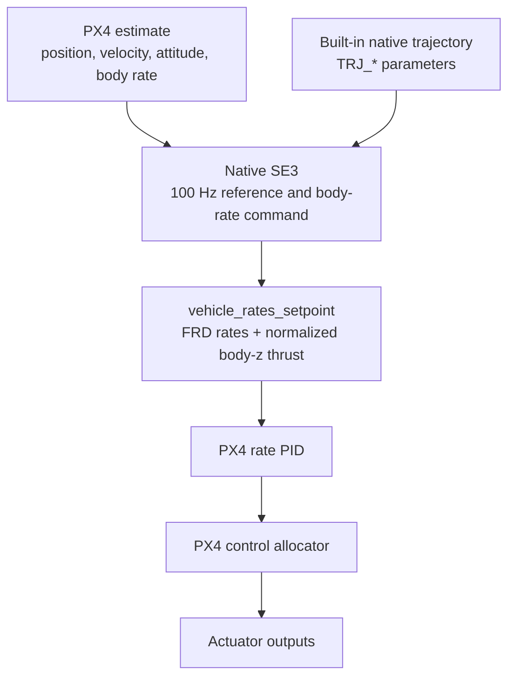

# Onboard SE3

Onboard SE3 is a native PX4 firmware mode for an already-flying, underactuated multicopter. It tracks a local NED position/heading reference and publishes **body-rate and normalized collective-thrust setpoints** internally. PX4 retains the rate controller, control allocator, actuator outputs, Commander mode management, and configured failsafes.

The installed PX4 revision is selected by [config/sources/px4.env](https://github.com/ANCL/px4-dev-toolkit/blob/main/config/sources/px4.env). The source links below follow the current `lab/main` firmware. See [Onboard control](../../operations/onboard.md) for operation, [Trajectories](../../experiments/trajectories.md) for reference definitions, and [Geometric control](../../mathematics/index.md) for the derivation.

## Control path and scheduling

[`Se3Runtime`](https://github.com/ANCL/PX4-Autopilot/blob/lab/main/src/modules/se3_control/Runtime.cpp) schedules a reference/control update every **10 ms** on PX4's `rate_ctrl` work queue. This is a nominal 100 Hz update schedule, not a measured timing guarantee. PX4's downstream rate controller runs from angular-velocity callbacks; its update rate is not set by SE3's 100 Hz schedule.

The mode enables only rate control and allocation in its Commander control configuration. Native position and attitude feedback controllers do not run its outer loop. `FlightModeManager` disables its flight tasks for registered external modes, so the native module owns the active trajectory reference publication.

SE3 publishes `vehicle_rates_setpoint` only while its own registered mode is selected, the required control flags match, and state/configuration are valid. It also publishes `vehicle_attitude_setpoint` as an observation of its exact desired rotation and thrust; that publication does not enable PX4's attitude controller.

## The active control law

Positions and velocities use PX4 local **NED**. Attitude \(R\) maps body
**FRD** into NED; angular velocity is expressed in body FRD. With
\(e_x=x-x_d\), \(e_v=v-v_d\) and \(e_3=[0,0,1]^T\), define the
**mass-normalized** gains \(\bar k_x=k_x/m\), \(\bar k_v=k_v/m\):

\[
a_c=a_d-\bar k_xe_x-\bar k_ve_v,
\qquad B=a_c-ge_3=A/m.
\]

The firmware computes the specific force \(B\) directly in m/s².
No vehicle mass is multiplied into or divided out of the geometric
reference. Its analytic derivatives come from jerk, snap and the nominal
rigid-body dynamics; estimator acceleration is not numerically differentiated.

The desired body z-axis is \(b_{3d}=-B/\lVert B\rVert\). The desired heading
completes the orthonormal rotation \(R_d\). Geometric attitude feedback uses

\[
e_R=\tfrac12(R_d^TR-R^TR_d)^\vee,
\qquad
\Omega_{\mathrm{sp}}=R^TR_d\Omega_d-K_Re_R.
\]

`SE3_KRX`, `SE3_KRY`, and `SE3_KRZ` are the diagonal entries of \(K_R\).
The desired angular-rate feedforward \(\Omega_d\) is analytical. The rate
command is clamped per axis to `SE3_RATE_MAX` rad/s at publication.

For current body z-axis \(b_3=Re_3\), the collective acceleration and
PX4-normalized thrust are

\[
u=-B\cdot b_3,
\qquad
u_T=\operatorname{clip}\!\left(\texttt{MPC\_THR\_HOVER}\frac{u}{g},0,1\right),
\qquad \texttt{thrust\_body}=[0,0,-u_T].
\]

Nonpositive or nonfinite \(u\) is rejected. PX4 runs the downstream rate PID
and control allocator. The mass-dependent physical-wrench output is specific
to the **ROS Offboard `geometric_physical`** controller, not this native
body-rate path. See the [Offboard SE3 implementation](../offboard/se3/index.md).

## Registration and reference lifecycle

SE3 registers at boot on the supported SITL/FMUV6C targets while disarmed.
Commander dynamically assigns its external flight-mode ID. Registration
does not select the mode or arm the aircraft.

| Event | Native behavior |
|---|---|
| `se3_control select` | Requests the SE3 navigation state; Commander may reject it. |
| Confirmed SE3 entry | Captures measured position and heading and holds them. |
| `se3_control trajectory <name>` | Reads current `TRJ_*` values, queues a named built-in reference and starts it from absolute NED. |
| Trajectory completion | Holds the final commanded reference without changing mode. |
| `se3_control hold` | Interrupts execution and captures the current measured pose. |
| Selection of another mode | Stops SE3 publication; the next entry captures a new hold pose. |

The firmware catalog contains `hover`, position steps/lines, two circles,
figure-eight, helix, yaw sweep, and full excitation. Names and math reside in
`src/lib/trajectory/`. Geometry, start pose, yaw and durations are controlled
by native PX4 parameters; they are not loaded from Offboard YAML files.

### Parameters and ownership

The firmware defines `SE3_ENABLE` (default `1`),
`SE3_KX=4`, `SE3_KV=3`, `SE3_KRX=5`, `SE3_KRY=5`,
`SE3_KRZ=2`, and `SE3_RATE_MAX=3` (rad/s).
`MPC_THR_HOVER` provides normalized thrust scaling.
The normalized native interface needs no vehicle mass parameter.

`TRJ_HOME_X`, `TRJ_HOME_Y`, `TRJ_HOME_Z`, `TRJ_HOME_YAW`,
the shape parameters (`TRJ_STEP_*`, `TRJ_LINE_*`, `TRJ_CIR*`,
`TRJ_F8_*`, `TRJ_HELIX_*`, `TRJ_YAW_ANG`), and the duration
parameters (`TRJ_*_T`, `TRJ_TURNS`) describe native trajectories.
Changing them affects new trajectory starts; an executing plan retains
its parameter snapshot. Inspect/edit them with `param show` / `param set`
and persist intentionally with `param save`.

Native `SE3_*`, `TRJ_*`, and `MPC_THR_HOVER` parameters are set in PX4
via the shell or QGroundControl, and persist when saved. The toolkit maintains
no duplicate native controller profiles.

Native parameters, rate PID, allocator geometry and estimator settings remain
PX4-owned. Offboard gains and `config/trajectories.yaml` are independent.

## Readiness and faults

Selection is for an **armed, airborne, non-VTOL rotary-wing aircraft**, with no active failsafe. The native health reply explicitly prevents arming in SE3. The runtime also requires received land-detection state, valid finite local position/velocity/heading, finite attitude and gyro state, configured positive finite gains/rate limit, and `0 < MPC_THR_HOVER < 1`.

Local-position and attitude timestamps must be at most **200 ms** old; gyro timestamps at most **100 ms** old. Attitude quaternion squared norm must lie strictly between `0.9` and `1.1`. The runtime explicitly excludes autostart IDs `6010` and `6002`; this exclusion is not proof that every other aircraft configuration is supported.

Once active, changes to local XY, local z, or quaternion estimator reset counters latch a fault. Invalid/stale state, failed trajectory sampling, or a failed geometric calculation also stops setpoint publication and latches a fault. Recovery of a stale sample alone does not resume execution. Exit the mode and disarm before the latched fault is cleared. Commander consumes the health replies and retains mode/failsafe authority; do not interpret the runtime's readiness checks as an independently validated flight-safety system.

The module can only be stopped while disarmed. Returning to pilot control uses a mode change, not module shutdown.

## Monitoring and evidence

`se3_control status` reports its Commander/arming-check IDs, enabled/active/faulted flags, and holding/running/completed state. Check these together with PX4's actual mode and aircraft state. While active, the module publishes standard `trajectory_setpoint` position, velocity, acceleration, jerk, yaw, and yaw rate for observation/recording. The dedicated `se3_trajectory_status` uORB message adds run ID, plan CRC32, phase, elapsed time, snap, and heading acceleration. It is an onboard ULog signal and is **not** exported through the pinned DDS topic configuration. A ROS bag therefore cannot recover all native run metadata; see [Onboard flight logging](../../experiments/onboard-logs.md).

Test coverage is recorded under [Validation scope](../../reference/architecture.md#validation-scope).
