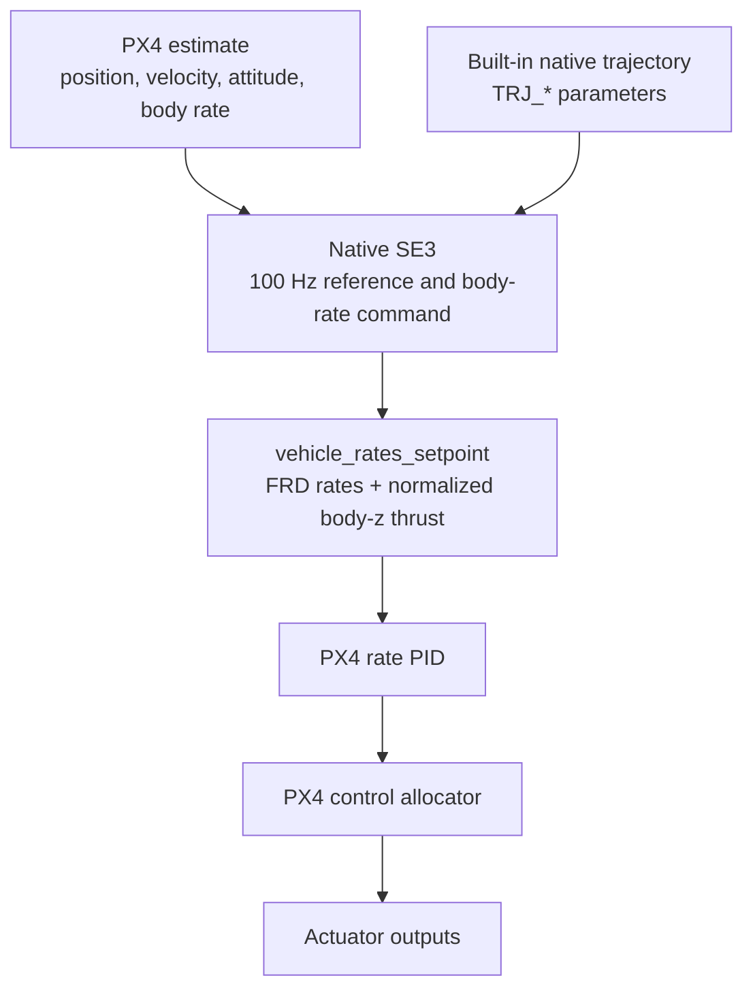

# Onboard SE3

Onboard SE3 is a native PX4 firmware mode for an already-flying, underactuated multicopter. It tracks a local NED position/heading reference and publishes **body-rate and normalized collective-thrust setpoints** internally. PX4 retains the rate controller, control allocator, actuator outputs, Commander mode management, and configured failsafes.

The installed PX4 revision is selected by [config/sources/px4.env](https://github.com/ANCL/px4-dev-toolkit/blob/main/config/sources/px4.env). The source links below follow the current `lab/main` firmware. See [Onboard control](../../operations/onboard.md) for operation, [Trajectories](../../experiments/trajectories.md) for reference definitions, and [Geometric control](../../mathematics/index.md) for the derivation.

## Control path and scheduling



[`Se3Runtime`](https://github.com/ANCL/PX4-Autopilot/blob/lab/main/src/modules/se3_control/Runtime.cpp) schedules a reference/control update every **10 ms** on PX4's `rate_ctrl` work queue. This is a nominal 100 Hz update schedule, not a measured timing guarantee. PX4's downstream rate controller runs from angular-velocity callbacks; its update rate is not set by SE3's 100 Hz schedule.

The mode enables only rate control and allocation in its Commander control configuration. Native position and attitude feedback controllers do not run its outer loop. `FlightModeManager` disables its flight tasks for registered external modes, so the native module owns the active trajectory reference publication.

SE3 publishes `vehicle_rates_setpoint` only while its own registered mode is selected, the required control flags match, and state/configuration are valid. It also publishes `vehicle_attitude_setpoint` as an observation of its exact desired rotation and thrust; that publication does not enable PX4's attitude controller.

## The active control law

Positions and velocities use PX4 local **NED**. Attitude \(R\) maps body
**FRD** into NED; angular velocity is expressed in body FRD. With
\(e_x=x-x_d\), \(e_v=v-v_d\) and \(e_3=[0,0,1]^T\), define the
**mass-normalized** gains \(\bar k_x=k_x/m\), \(\bar k_v=k_v/m\):

\[
a_c=a_d-\bar k_xe_x-\bar k_ve_v,
\qquad B=a_c-ge_3=A/m.
\]

The firmware computes the specific force \(B\) directly in m/s².
No vehicle mass is multiplied into or divided out of the geometric
reference. Its analytic derivatives come from jerk, snap and the nominal
rigid-body dynamics; estimator acceleration is not numerically differentiated.

The desired body z-axis is \(b_{3d}=-B/\lVert B\rVert\). The desired heading
completes the orthonormal rotation \(R_d\). Geometric attitude feedback uses

\[
e_R=\tfrac12(R_d^TR-R^TR_d)^\vee,
\qquad
\Omega_{\mathrm{sp}}=R^TR_d\Omega_d-K_Re_R.
\]

`SE3_KRX`, `SE3_KRY`, and `SE3_KRZ` are the diagonal entries of \(K_R\).
The desired angular-rate feedforward \(\Omega_d\) is analytical. The rate
command is clamped per axis to `SE3_RATE_MAX` rad/s at publication.

For current body z-axis \(b_3=Re_3\), the collective acceleration and
PX4-normalized thrust are

\[
u=-B\cdot b_3,
\qquad
u_T=\operatorname{clip}\!\left(\texttt{MPC\_THR\_HOVER}\frac{u}{g},0,1\right),
\qquad \texttt{thrust\_body}=[0,0,-u_T].
\]

Nonpositive or nonfinite \(u\) is rejected. PX4 runs the downstream rate PID
and control allocator. The mass-dependent physical-wrench output is specific
to the **ROS Offboard `geometric_physical`** controller, not this native
body-rate path. See the [Offboard SE3 implementation](../offboard/se3/index.md).

## Registration and reference lifecycle

SE3 registers at boot on the supported SITL/FMUV6C targets while disarmed.
Commander dynamically assigns its external flight-mode ID. Registration
does not select the mode or arm the aircraft.

| Event | Native behavior |
|---|---|
| `se3_control select` | Requests the SE3 navigation state; Commander may reject it. |
| Confirmed SE3 entry | Captures measured position and heading and holds them. |
| `se3_control trajectory <name>` | Reads current `TRJ_*` values, queues a named built-in reference and starts it from absolute NED. |
| Trajectory completion | Holds the final commanded reference without changing mode. |
| `se3_control hold` | Interrupts execution and captures the current measured pose. |
| Selection of another mode | Stops SE3 publication; the next entry captures a new hold pose. |

The firmware catalog contains `hover`, position steps/lines, two circles,
figure-eight, helix, yaw sweep, and full excitation. Names and math reside in
`src/lib/trajectory/`. Geometry, start pose, yaw and durations are controlled
by native PX4 parameters; they are not loaded from Offboard YAML files.

### Parameters and ownership

All `SE3_*` and `TRJ_*` values below are **native PX4 parameters**. Their defaults come from the firmware's [parameter definitions](https://github.com/ANCL/PX4-Autopilot/blob/lab/main/src/modules/se3_control/module.yaml); the [trajectory catalog](https://github.com/ANCL/PX4-Autopilot/blob/lab/main/src/lib/trajectory/Catalog.cpp) determines which motion uses each value. They are not loaded from Offboard YAML or toolkit parameter files.

#### Controller parameters

| Parameter | Default | Effect of changing it |
|---|---:|---|
| `SE3_ENABLE` | `1` | `1` permits selection when ready; `0` prevents it. |
| `SE3_KX` | `4.0` s⁻² | Position-error gain divided by mass. Higher produces stronger position correction. |
| `SE3_KV` | `3.0` s⁻¹ | Velocity-error gain divided by mass. Higher increases velocity correction and damping. |
| `SE3_KRX` | `5.0` s⁻¹ | Roll attitude-to-rate feedback. Higher requests faster roll correction. |
| `SE3_KRY` | `5.0` s⁻¹ | Pitch attitude-to-rate feedback. Higher requests faster pitch correction. |
| `SE3_KRZ` | `2.0` s⁻¹ | Yaw attitude-to-rate feedback. Higher requests faster yaw correction. |
| `SE3_RATE_MAX` | `3.0` rad/s | Per-axis body-rate limit. Lower caps commanded rotation more tightly. |

The translational gains are **already mass-normalized**; SE3 does not need an `SE3_MASS` parameter. All five gains must be finite and **strictly positive** for mode readiness, even though the parameter metadata allows zero. Increasing gains can improve responsiveness but also amplify overshoot, oscillation or rate/actuator saturation. These defaults are not hardware-validated tuning.

`MPC_THR_HOVER` is a **standard PX4 parameter**, not defined by this module; inspect the value on the vehicle rather than assuming a universal default. It scales the same collective-acceleration request into normalized thrust. A higher value gives a larger normalized thrust request for the same acceleration. SE3 requires a finite value strictly between 0 and 1. Determine it from the airframe's hover-thrust calibration, not by guessing a controller gain.

#### Trajectory origin and geometry

All coordinates are **absolute PX4 local NED**, while size and height parameters are offsets relative to the `TRJ_HOME_*` origin. X is north, Y east, and Z positive downward.

| Parameter | Default | What it changes |
|---|---:|---|
| `TRJ_HOME_X` | `0.0` m | Absolute reference X for every built-in trajectory. |
| `TRJ_HOME_Y` | `0.0` m | Absolute reference Y for every built-in trajectory. |
| `TRJ_HOME_Z` | `-1.0` m | Absolute reference height; more negative means higher. |
| `TRJ_HOME_YAW` | `0.0` rad | Initial heading and reference heading outside yaw sweeps. |
| `TRJ_STEP_X` | `1.0` m | Positive X step in `step_x` and `full_excitation`. |
| `TRJ_STEP_Y` | `1.0` m | Positive Y step in `step_y` and `full_excitation`. |
| `TRJ_LINE_X` | `0.5` m | X travel in `line_x`. |
| `TRJ_LINE_Y` | `0.5` m | Y travel in `line_y`. |
| `TRJ_LINE_DZ` | `-0.25` m | Relative Z travel in `line_z` and `full_excitation`; negative climbs. |
| `TRJ_CIR05_R` | `0.5` m | Radius of `circle_r05`. |
| `TRJ_CIR10_R` | `1.0` m | Radius of `circle_r10`. |
| `TRJ_HELIX_R` | `1.0` m | Radius of `helix_r10`. |
| `TRJ_HELIX_H` | `-0.5` m | Signed vertical travel over the helix; negative climbs. |
| `TRJ_F8_AX` | `0.75` m | Figure-eight X amplitude. |
| `TRJ_F8_AY` | `1.2` m | Figure-eight Y amplitude. |
| `TRJ_YAW_ANG` | `1.57079632679` rad | Relative yaw-sweep angle (90° by default). |

Larger distances, radii or amplitudes increase the excursion. For unchanged duration and turn count, they generally demand higher velocities and accelerations. `TRJ_HOME_*` changes **do not** align a trajectory to the current aircraft pose.

#### Trajectory timing and repetition

| Parameter | Default | What it changes |
|---|---:|---|
| `TRJ_HOVER_T` | `10.0` s | Duration of `hover`. |
| `TRJ_HOLD_T` | `2.0` s | Holds before/between/after moves in many presets. |
| `TRJ_STEP_T` | `4.0` s | **Dwell after an instantaneous step**; does not smooth the jump. |
| `TRJ_LINE_T` | `4.0` s | Duration of X/Y/Z lines and full-excitation Z segments. |
| `TRJ_RETURN_T` | `5.0` s | Return-to-home line duration for steps, lines, circles and full excitation. |
| `TRJ_CIR05_T` | `12.0` s | Duration of the smaller circle. |
| `TRJ_CIR10_T` | `20.0` s | Duration of the larger circle. |
| `TRJ_F8_T` | `60.0` s | Figure-eight duration, including its full-excitation segment. |
| `TRJ_HELIX_T` | `20.0` s | Helix curved-segment duration. |
| `TRJ_YAW_T` | `4.0` s | Duration of each outbound/return yaw sweep. |
| `TRJ_TURNS` | `3` | Revolutions in circles, helix and figure-eight. |

For fixed geometry and turns, **increasing duration slows the commanded motion**; reducing duration makes it more aggressive. Increasing `TRJ_TURNS` at fixed duration increases angular travel and typically required speed. Circle entry lines are fixed at 5 s (`circle_r05`) and 10 s (`circle_r10`); the helix has a fixed 10 s entry and 8 s return. These fixed durations are not changed by `TRJ_LINE_T` or `TRJ_RETURN_T`.

The firmware catalog has 12 names: `hover`, `step_x`, `step_y`, `line_x`, `line_y`, `line_z`, `circle_r05`, `circle_r10`, `figure_eight_tracking`, `helix_r10`, `yaw_sweep`, and `full_excitation`. Each preset uses only its relevant fields, but the firmware reads the complete native trajectory parameter set when a trajectory is requested.

#### Inspect, change and save

In the **PX4 shell**, while disarmed, inspect parameters first:

```text
param show SE3_KX
param show SE3_KV
param show SE3_RATE_MAX
param show MPC_THR_HOVER
param show TRJ_HOME_Z
param show TRJ_F8_T
```

For example, after checking the flight volume and desired absolute NED start, configure a -2.5 m reference altitude and a slower 80 s figure-eight:

```text
param set TRJ_HOME_Z -2.5
param set TRJ_F8_T 80
param show TRJ_HOME_Z
param show TRJ_F8_T
param save
```

These are examples, **not automatically safe values for an aircraft**. `param set` changes a PX4 parameter; `param save` persists it across reboot. Controller parameters can affect subsequent control updates, so do not tune them during flight. `TRJ_*` settings are snapshotted **when `se3_control trajectory <name>` is requested**; edits during execution do not change that run.

#### What to adjust

| Observation | Parameter to examine | Trade-off |
|---|---|---|
| Position response is slow | `SE3_KX`, `SE3_KV` | Stronger correction can improve response but can overshoot or saturate. |
| Position overshoots or oscillates | `SE3_KV`, `SE3_KX` | More velocity damping or less position gain can help; inspect actuator limits first. |
| Roll/pitch/yaw correction is too aggressive | `SE3_KRX/KRY/KRZ` | Smaller gains request gentler rate corrections. |
| Body-rate command is clipped | `SE3_RATE_MAX` | A higher cap permits faster rotation but does not add actuator authority. |
| Hover thrust is mis-scaled | `MPC_THR_HOVER` | Verify calibration and vehicle data; do not mask an actuator/model issue. |
| Reference motion is too aggressive | `TRJ_*_T`, amplitudes, `TRJ_TURNS` | Increase duration, reduce displacement or reduce turns. |
| Trajectory starts away from the aircraft | `TRJ_HOME_*` | Verify the absolute local-NED origin and measured start pose. |

Change one factor at a time and assess the response and allocator saturation in SITL before considering hardware. Native parameter settings, PX4 rate PID, estimator and allocator remain firmware-owned. Offboard gains and `config/trajectories.yaml` are independent.

## Readiness and faults

Selection is for an **armed, airborne, non-VTOL rotary-wing aircraft**, with no active failsafe. The native health reply explicitly prevents arming in SE3. The runtime also requires received land-detection state, valid finite local position/velocity/heading, finite attitude and gyro state, configured positive finite gains/rate limit, and `0 < MPC_THR_HOVER < 1`.

Local-position and attitude timestamps must be at most **200 ms** old; gyro timestamps at most **100 ms** old. Attitude quaternion squared norm must lie strictly between `0.9` and `1.1`. The runtime explicitly excludes autostart IDs `6010` and `6002`; this exclusion is not proof that every other aircraft configuration is supported.

Once active, changes to local XY, local z, or quaternion estimator reset counters latch a fault. Invalid/stale state, failed trajectory sampling, or a failed geometric calculation also stops setpoint publication and latches a fault. Recovery of a stale sample alone does not resume execution. Exit the mode and disarm before the latched fault is cleared. Commander consumes the health replies and retains mode/failsafe authority; do not interpret the runtime's readiness checks as an independently validated flight-safety system.

The module can only be stopped while disarmed. Returning to pilot control uses a mode change, not module shutdown.

## Monitoring and evidence

`se3_control status` reports its Commander/arming-check IDs, enabled/active/faulted flags, and holding/running/completed state. Check these together with PX4's actual mode and aircraft state. While active, the module publishes standard `trajectory_setpoint` position, velocity, acceleration, jerk, yaw, and yaw rate for observation/recording. The dedicated `se3_trajectory_status` uORB message adds run ID, plan CRC32, phase, elapsed time, snap, and heading acceleration. It is an onboard ULog signal and is **not** exported through the pinned DDS topic configuration. A ROS bag therefore cannot recover all native run metadata; see [Onboard flight logging](../../experiments/onboard-logs.md).

Test coverage is recorded under [Validation scope](../../reference/architecture.md#validation-scope).
