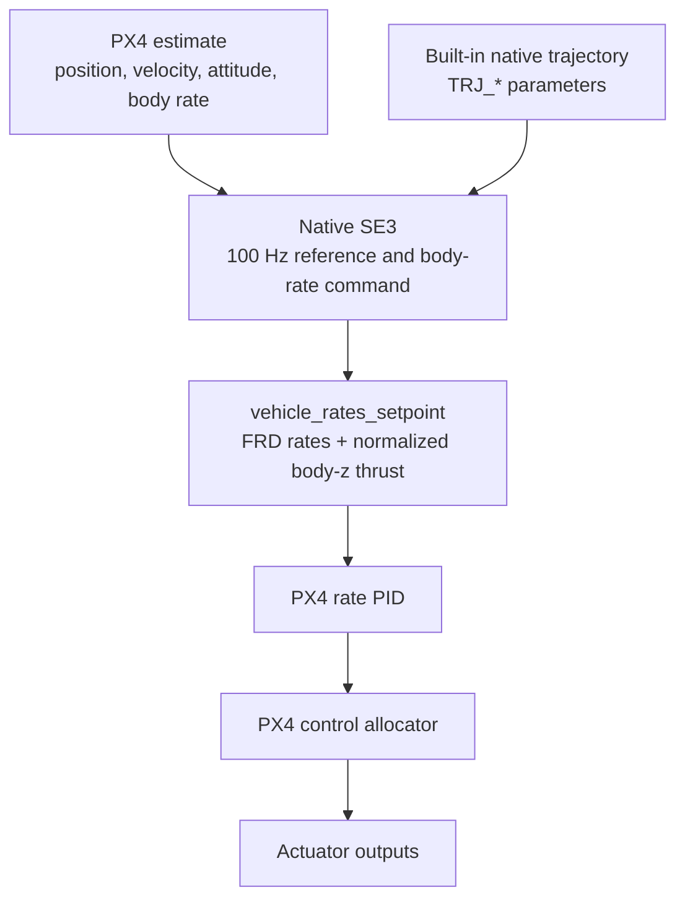

# Onboard SE3

Onboard SE3 is a native PX4 firmware mode for an already-flying, underactuated multicopter. It tracks a local NED position/heading reference and publishes **body-rate and normalized collective-thrust setpoints** internally. PX4 retains the rate controller, control allocator, actuator outputs, Commander mode management, and configured failsafes.

The installed PX4 revision is selected by [config/sources/px4.env](https://github.com/ANCL/px4-dev-toolkit/blob/main/config/sources/px4.env). The source links below follow the current `lab/main` firmware. See [Onboard control](../../operations/onboard.md) for operation, [Trajectories](../../experiments/trajectories.md) for reference definitions, and [Geometric control](../../mathematics/index.md) for the derivation.

## Control path and scheduling



[`Se3Runtime`](https://github.com/ANCL/PX4-Autopilot/blob/lab/main/src/modules/se3_control/Runtime.cpp) schedules a reference/control update every **10 ms** on PX4's `rate_ctrl` work queue. This is a nominal 100 Hz update schedule, not a measured timing guarantee. PX4's downstream rate controller runs from angular-velocity callbacks; its update rate is not set by SE3's 100 Hz schedule.

The mode enables only rate control and allocation in its Commander control configuration. Native position and attitude feedback controllers do not run its outer loop. `FlightModeManager` disables its flight tasks for registered external modes, so the native module owns the active trajectory reference publication.

SE3 publishes `vehicle_rates_setpoint` only while its own registered mode is selected, the required control flags match, and state/configuration are valid. It also publishes `vehicle_attitude_setpoint` as an observation of its exact desired rotation and thrust; that publication does not enable PX4's attitude controller.

## The active control law

Positions and velocities use PX4 local **NED**. Attitude \(R\) maps body
**FRD** into NED; angular velocity is expressed in body FRD. With
\(e_x=x-x_d\), \(e_v=v-v_d\) and \(e_3=[0,0,1]^T\), define the
**mass-normalized** gains \(\bar k_x=k_x/m\), \(\bar k_v=k_v/m\):

\[
a_c=a_d-\bar k_xe_x-\bar k_ve_v,
\qquad B=a_c-ge_3=A/m.
\]

The firmware computes the specific force \(B\) directly in m/s².
No vehicle mass is multiplied into or divided out of the geometric
reference. Its analytic derivatives come from jerk, snap and the nominal
rigid-body dynamics; estimator acceleration is not numerically differentiated.

The desired body z-axis is \(b_{3d}=-B/\lVert B\rVert\). The desired heading
completes the orthonormal rotation \(R_d\). Geometric attitude feedback uses

\[
e_R=\tfrac12(R_d^TR-R^TR_d)^\vee,
\qquad
\Omega_{\mathrm{sp}}=R^TR_d\Omega_d-K_Re_R.
\]

`SE3_KRX`, `SE3_KRY`, and `SE3_KRZ` are the diagonal entries of \(K_R\).
The desired angular-rate feedforward \(\Omega_d\) is analytical. The rate
command is clamped per axis to `SE3_RATE_MAX` rad/s at publication.

For current body z-axis \(b_3=Re_3\), the collective acceleration and
PX4-normalized thrust are

\[
u=-B\cdot b_3,
\qquad
u_T=\operatorname{clip}\!\left(\texttt{MPC\_THR\_HOVER}\frac{u}{g},0,1\right),
\qquad \texttt{thrust\_body}=[0,0,-u_T].
\]

Nonpositive or nonfinite \(u\) is rejected. PX4 runs the downstream rate PID
and control allocator. The mass-dependent physical-wrench output is specific
to the **ROS Offboard `geometric_physical`** controller, not this native
body-rate path. See the [Offboard SE3 implementation](../offboard/se3/index.md).

## Registration and reference lifecycle

SE3 registers at boot on the supported SITL/FMUV6C targets while disarmed.
Commander dynamically assigns its external flight-mode ID. Registration
does not select the mode or arm the aircraft.

| Event | Native behavior |
|---|---|
| `se3_control select` | Requests the SE3 navigation state; Commander may reject it. |
| Confirmed SE3 entry | Captures measured position and heading and holds them. |
| `se3_control trajectory <name>` | Reads current `TRJ_*` values, queues a named built-in reference and starts it from absolute NED. |
| Trajectory completion | Holds the final commanded reference without changing mode. |
| `se3_control hold` | Interrupts execution and captures the current measured pose. |
| Selection of another mode | Stops SE3 publication; the next entry captures a new hold pose. |

The firmware exposes four named trajectories: `setpoint`, `steps5`, `circle`, and
`figure8`. All reference generation lives inside
[`src/modules/se3_control/trajectory/`](https://github.com/ANCL/PX4-Autopilot/tree/lab/main/src/modules/se3_control/trajectory).
There is no separate trajectory process, uploaded plan, or Offboard YAML dependency.

### Parameters and ownership

The native `SE3_*` and `TRJ_*` defaults are defined in
[`module.yaml`](https://github.com/ANCL/PX4-Autopilot/blob/lab/main/src/modules/se3_control/module.yaml).
The [trajectory catalog](https://github.com/ANCL/PX4-Autopilot/blob/lab/main/src/modules/se3_control/trajectory/Catalog.cpp)
defines the built-in references. PX4 owns these parameters independently of
the toolkit's ROS 2 Offboard configuration.

#### Controller parameters

| Parameter | Default | Effect of changing it |
|---|---:|---|
| `SE3_ENABLE` | `1` | `1` permits selection when ready; `0` prevents it. |
| `SE3_KX` | `4.0` s⁻² | Position-error gain divided by mass. Higher produces stronger position correction. |
| `SE3_KV` | `3.0` s⁻¹ | Velocity-error gain divided by mass. Higher increases velocity correction and damping. |
| `SE3_KRX` | `5.0` s⁻¹ | Roll attitude-to-rate feedback. Higher requests faster roll correction. |
| `SE3_KRY` | `5.0` s⁻¹ | Pitch attitude-to-rate feedback. Higher requests faster pitch correction. |
| `SE3_KRZ` | `2.0` s⁻¹ | Yaw attitude-to-rate feedback. Higher requests faster yaw correction. |
| `SE3_RATE_MAX` | `3.0` rad/s | Per-axis body-rate limit. Lower caps commanded rotation more tightly. |

The translational gains are **already mass-normalized**; SE3 does not need an `SE3_MASS` parameter. All five gains must be finite and **strictly positive** for mode readiness, even though the parameter metadata allows zero. Increasing gains can improve responsiveness but also amplify overshoot, oscillation or rate/actuator saturation. These defaults are not hardware-validated tuning.

`MPC_THR_HOVER` is a **standard PX4 parameter**, not defined by this module; inspect the value on the vehicle rather than assuming a universal default. It scales the same collective-acceleration request into normalized thrust. A higher value gives a larger normalized thrust request for the same acceleration. SE3 requires a finite value strictly between 0 and 1. Determine it from the airframe's hover-thrust calibration, not by guessing a controller gain.

#### Built-in trajectories

| Name | Reference | Configuration |
|---|---|---|
| `setpoint` | Absolute position and yaw; live edits are immediate steps | `TRJ_SP_X/Y/Z/YAW` |
| `steps5` | Five fixed absolute NED points with instantaneous transitions | `TRJ_STEP_HOLD` |
| `circle` | Centered at `TRJ_HOME_*`, starting at its +X edge | `TRJ_CIR_*`, `TRJ_HOME_*` |
| `figure8` | Centered at `TRJ_HOME_*`, starting at the center | `TRJ_F8_*`, `TRJ_HOME_*` |

The five `steps5` positions (metres), in order, are `(0, 0, -0.75)`,
`(0.25, 0, -0.75)`, `(0, 0, -0.75)`, `(0, 0.25, -0.75)`, and
`(0, 0, -0.75)`. Each point is held for `TRJ_STEP_HOLD` seconds;
the transition is an immediate step, not a timed motion. These points are
hardcoded and independent of `TRJ_HOME_*`.

#### Trajectory parameters

| Parameter | Default | Purpose |
|---|---:|---|
| `TRJ_SP_X` | 0 m | Live X reference |
| `TRJ_SP_Y` | 0 m | Live Y reference |
| `TRJ_SP_Z` | -0.75 m | Live Z reference |
| `TRJ_SP_YAW` | 0 rad | Live heading |
| `TRJ_STEP_HOLD` | 3 s | Dwell at each fixed step |
| `TRJ_HOME_X` | 0 m | Circle/figure-eight center X |
| `TRJ_HOME_Y` | 0 m | Circle/figure-eight center Y |
| `TRJ_HOME_Z` | -0.75 m | Circle/figure-eight center Z |
| `TRJ_HOME_YAW` | 0 rad | Circle/figure-eight heading |
| `TRJ_CIR_R` | 0.5 m | Circle radius |
| `TRJ_CIR_T` | 20 s | Total circle duration |
| `TRJ_CIR_TURNS` | 1 | Circle revolutions |
| `TRJ_F8_AX` | 0.5 m | Figure-eight X amplitude |
| `TRJ_F8_AY` | 0.5 m | Figure-eight Y amplitude |
| `TRJ_F8_T` | 30 s | Total figure-eight duration |
| `TRJ_F8_TURNS` | 1 | Figure-eight cycles |

All coordinates are absolute PX4 local NED (Z positive downward). Circle
starts at `(TRJ_HOME_X + TRJ_CIR_R, TRJ_HOME_Y, TRJ_HOME_Z)`; figure-eight
starts at `(TRJ_HOME_X, TRJ_HOME_Y, TRJ_HOME_Z)`. Their time parameters
specify the total duration across 1–10 turns/cycles. Neither reference
shifts automatically to the measured aircraft position.

#### Inspect and execute

In the **PX4 shell**, inspect the configuration:

```text
se3_control list
param show SE3_*
param show TRJ_*
```

After airborne mode selection and confirmation of an active, holding SE3 mode:

```text
se3_control trajectory figure8
se3_control status
se3_control hold
```

`trajectory` takes exactly **one name**, without another `start` argument.
A new trajectory can only start when SE3 is active and holding. Explicit
`se3_control hold` captures the **measured** position and heading; normal
completion of a finite trajectory holds its final **commanded** reference.

An active `setpoint` reads `TRJ_SP_*` changes live from PX4 parameters:

```text
se3_control trajectory setpoint
param set TRJ_SP_X 0.25
se3_control hold
```

Use the example only if those absolute coordinates are safe for the current
vehicle. Parameter edits produce **instantaneous reference steps**, not
smoothed travel. Live setpoint execution continues until interrupted. All
other trajectory parameters are snapshotted at the request to start a run.

#### Tuning boundaries

Change `SE3_*` feedback gains separately from reference geometry and timing.
`MPC_THR_HOVER` is a standard PX4 hover-thrust calibration parameter. Inspect
actuator/rate saturation when tuning. Defaults are not hardware-validated.

## Readiness and faults

Selection is for an **armed, airborne, non-VTOL rotary-wing aircraft**, with no active failsafe. The native health reply explicitly prevents arming in SE3. The runtime also requires received land-detection state, valid finite local position/velocity/heading, finite attitude and gyro state, configured positive finite gains/rate limit, and `0 < MPC_THR_HOVER < 1`.

Local-position and attitude timestamps must be at most **200 ms** old; gyro timestamps at most **100 ms** old. Attitude quaternion squared norm must lie strictly between `0.9` and `1.1`. The runtime explicitly excludes autostart IDs `6010` and `6002`; this exclusion is not proof that every other aircraft configuration is supported.

Once active, changes to local XY, local z, or quaternion estimator reset counters latch a fault. Invalid/stale state, failed trajectory sampling, or a failed geometric calculation also stops setpoint publication and latches a fault. Recovery of a stale sample alone does not resume execution. Exit the mode and disarm before the latched fault is cleared. Commander consumes the health replies and retains mode/failsafe authority; do not interpret the runtime's readiness checks as an independently validated flight-safety system.

The module can only be stopped while disarmed. Returning to pilot control uses a mode change, not module shutdown.

## Monitoring and evidence

`se3_control status` reports its Commander/arming-check IDs, enabled/active/faulted flags, and holding/running/completed state. Check these together with PX4's actual mode and aircraft state. While active, the module publishes standard `trajectory_setpoint` position, velocity, acceleration, jerk, yaw, and yaw rate for observation/recording. The dedicated `se3_trajectory_status` uORB message adds run ID, plan CRC32, phase, elapsed time, snap, and heading acceleration. It is an onboard ULog signal and is **not** exported through the pinned DDS topic configuration. A ROS bag therefore cannot recover all native run metadata; see [Onboard flight logging](../../experiments/onboard-logs.md).

Test coverage is recorded under [Validation scope](../../reference/architecture.md#validation-scope).
