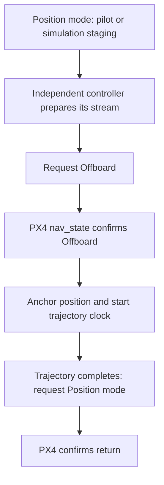

# Position mode and switching to Offboard

In **PX4 Position mode**, PX4 stabilizes the aircraft and uses position/velocity feedback while pilot stick input requests motion. On physical aircraft, the pilot normally uses a real transmitter or joystick. The simulation examples use the MAVProxy virtual joystick to make part of that input repeatable.

## Native Position-mode reference experiment

Use a prepared SITL environment with `GCS=mavproxy`, valid PX4 state, no competing controller, and an initially landed/disarmed simulated aircraft. In a **second repository-root shell**:

```bash
source ros2/runtime_env.sh
ros2 launch px4_position_mode position_takeoff_hover.launch.py
```

The [reference example](https://github.com/ANCL/px4-dev-toolkit/tree/main/ros2/src/px4_position_mode/src/takeoff_hover) performs readiness checks, Position-mode selection, arm, climb, hover, landing, and disarm. It does not calculate an external position feedback law. Add `record:=true` to record its messages.

## Position-mode staging helper

The [staging helper](https://github.com/ANCL/px4-dev-toolkit/tree/main/ros2/src/px4_position_mode/src/offboard_staging) prepares a simulation for an **independent** Offboard controller. In a prepared **SITL repository-root shell**:

```bash
source ros2/runtime_env.sh
ros2 launch px4_position_mode offboard_takeoff_handoff.launch.py
```

It supplies minimum-throttle input, selects Position mode, arms, climbs to the configured staging altitude, centers the joystick to hold, then waits for another controller to enter Offboard. It exits after takeover; it never requests Offboard itself. Staging parameters are in [offboard.yaml](https://github.com/ANCL/px4-dev-toolkit/blob/main/ros2/src/px4_position_mode/config/offboard.yaml). Start the separate controller only once staging has reached its hold phase.

These are two different demonstrations. The reference flight lands and disarms; the staging helper leaves the aircraft ready for a separate controller. Do not run them concurrently.

## Offboard transition

**Offboard** means PX4 accepts an external controller's chosen command type. A ROS heartbeat (`OffboardControlMode`) tells PX4 which level is active. The controller requests the mode change and checks `VehicleStatus.nav_state` for confirmation; an accepted command acknowledgement alone does not start trajectory time.



[Offboard position](offboard-position.md) streams a heartbeat and actual trajectory setpoints before requesting takeover. [SE(3)](se3.md#when-the-controller-starts-and-stops) warms up heartbeat and its diagnostic trajectory reference; its selected control output begins after confirmed entry. Their failure and return behavior also differs, so check the controller's own page.

A confirmed return to Position mode ends the controller experiment, not necessarily the flight. Plan the subsequent pilot-controlled landing/disarm. Interrupting a controller can remove its stream and invoke PX4's configured failsafe rather than a controlled return.

Continue with [Offboard position control](offboard-position.md).
