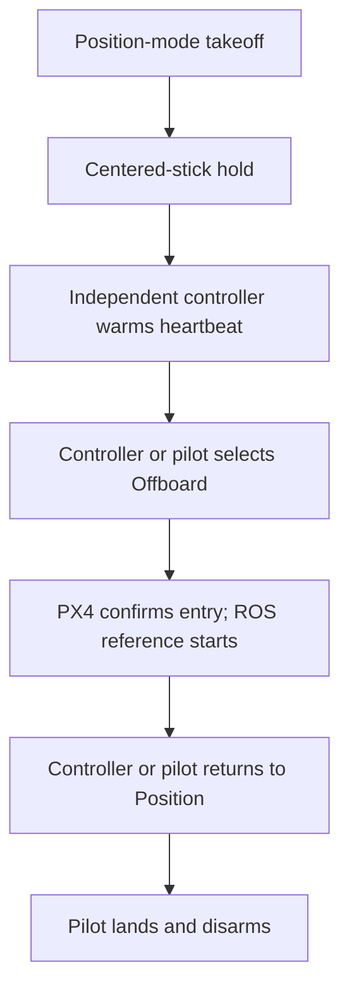

# Offboard Staging

This SITL helper uses MAVProxy's virtual joystick to take off in Position mode and wait for an independent Offboard controller. It exits after confirmed handoff, leaving the aircraft airborne.

## Prepare the aircraft

Use a prepared SITL environment with `GCS=mavproxy`, valid PX4 state, no competing controller, and an initially landed/disarmed aircraft. In an Ubuntu repository-root shell:

```bash
source ros2/runtime_env.sh
ros2 launch px4_position_mode offboard_takeoff_handoff.launch.py
```

The helper selects Position mode, checks readiness, arms, and climbs to the `initial_z` threshold before centering the joystick. Launch the Offboard controller after the helper reports its hold phase.

The launch reads the **installed** `px4_position_mode/config/offboard.yaml`, rather than the checkout-first configuration loader used by the Offboard controllers. Its source is [offboard.yaml](https://github.com/ANCL/px4-dev-toolkit/blob/main/ros2/src/px4_position_mode/config/offboard.yaml). Rebuild/install the ROS package after editing that source file; changing the source alone does not update the installed copy.

### Check the starting position

The pinned staging target is `initial_z=-2.0` m, while the shared trajectory start is `[0,0,-1.0]` m. Those defaults differ by one metre. The helper uses the altitude threshold only; it does not navigate to `initial_x`, `initial_y`, or `initial_yaw` even though the YAML supplies them. Centered sticks hold the attained Position-mode pose.

Before takeover, compare measured NED position/heading with the selected trajectory's fixed start. Offboard entry does not translate that reference to the hover pose, so the default staging workflow can command a descent toward Z = −1 m. For the standard start near local Z = −1 m, the [Position-mode helper](position-mode.md#reference-flight) offers a `height:=1.0 finish:=hold` preparation from the ground near Z = 0; confirm the resulting measured pose rather than assuming exact alignment.

## Offboard transition

The independent controller's heartbeat declares the command level; the controller or pilot then selects Offboard. Both controllers verify `VehicleStatus.nav_state`, rather than treating a command acknowledgement as ownership. Both begin their trajectory clock on confirmed entry. Their trajectories execute in ROS and stream over DDS; no PX4 `trajectory start` command is used for these Offboard paths.



[Offboard Position](../offboard/position.md) prestreams actual trajectory setpoints. [Offboard SE(3)](../offboard/se3/index.md#when-the-controller-starts-and-stops) prestreams its heartbeat and diagnostic reference but starts the selected PX4 control output after confirmed entry. See [Offboard control](../../operations/offboard.md) for automatic/external activation and recovery.

## After handoff

After handoff, MAVProxy keeps its virtual joystick centered. Follow [Land and reset](../../operations/sitl.md#land-and-reset-the-simulated-vehicle) after the controller returns to Position mode.

On controller failure or lost Offboard stream, check PX4's actual mode and recover through pilot control. This helper runs in SITL only. Implementation: [offboard_staging/lifecycle.cpp](https://github.com/ANCL/px4-dev-toolkit/blob/main/ros2/src/px4_position_mode/src/offboard_staging/lifecycle.cpp).
