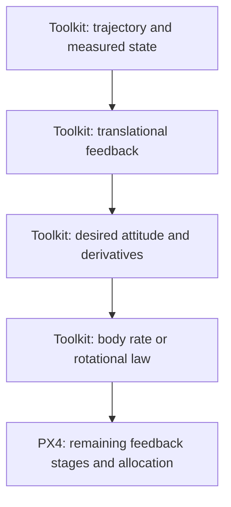

<!-- Preserve existing section links. -->
<span id="geometric-se3-controller"></span>

# SE(3) control

**SE(3)** combines a position in three-dimensional space with a rotation in **SO(3)**, the set of proper three-dimensional rotation matrices. For a multicopter, position feedback determines a desired force, and that force plus heading determines an attitude. The toolkit can stop its calculation at several stages and ask PX4 to calculate the rest.

<!-- Preserve existing section links. -->
<span id="runtime-flow"></span>
<span id="control-ownership"></span>

## Six configurations



The diagram shows the complete calculation. Each configuration publishes earlier or later in it:

| Configuration | Launch selection | Sent to PX4 | PX4 calculates next |
|---|---|---|---|
| [Acceleration](se3/acceleration.md) | `handoff:=acceleration` | `TrajectorySetpoint` acceleration | Attitude/thrust conversion and lower loops |
| [Attitude](se3/attitude.md) | `handoff:=attitude` | `VehicleAttitudeSetpoint` | Attitude/rate feedback and allocation |
| [Attitude rate](se3/attitude-rate.md) | `handoff:=attitude_rate` | `VehicleRatesSetpoint` | Rate feedback and allocation |
| [Geometric normalized](se3/geometric-normalized.md) | `handoff:=thrust_and_torque direct_controller:=geometric_normalized` | Normalized thrust and torque | Allocation |
| [PX4 rate](se3/px4-rate.md) | `handoff:=thrust_and_torque direct_controller:=px4_rate` | Normalized thrust and torque | Allocation |
| [Geometric physical](se3/geometric-physical.md) | `handoff:=thrust_and_torque direct_controller:=geometric_physical` | Physical wrench converted to normalized thrust and torque | Allocation |

The geometric normalized law uses SO(3) tracking errors directly in normalized torque coordinates. The PX4 rate option reproduces a particular pinned rate loop. The physical law computes an inertia-based moment and uses a separate adapter. They are distinct controllers, even though they publish the same PX4 message types.

<!-- Preserve existing section links. -->
<span id="launch"></span>

## Run a controller

First prepare an airborne, state-ready SITL vehicle in Position mode, for example with the [staging helper](position-mode.md#position-mode-staging-helper). SE(3) does **not** arm or take off. Ensure the simulator and selected vehicle file agree, and no competing controller is publishing.

In a **separate repository-root shell**:

```bash
source ros2/runtime_env.sh
ros2 launch offboard_controllers se3.launch.py \
  vehicle:=gz_f450 trajectory:=hover handoff:=acceleration \
  publish_diagnostics:=true
```

`hover` holds the anchored entry position for two seconds. Use a [named trajectory](trajectories.md) for longer motion and add `record:=true` when you want a bag.

## When the controller starts and stops

The wall timer publishes the Offboard heartbeat even while waiting for state. Ready updates publish the generated `/se3/trajectory_reference` at trajectory time zero. The checked-in warmup is 1.5 s, with mode-request retries every 1 s; these durations are converted to ready-update counts at the configured outer rate (100 Hz by default).

**The actual selected control setpoints begin after confirmed Offboard entry.** The pre-entry stream is the heartbeat and diagnostic trajectory reference, not the acceleration/attitude/rate/wrench output. This is the behavior of [runtime/lifecycle.cpp](https://github.com/ANCL/px4-dev-toolkit/blob/main/ros2/src/offboard_controllers/src/se3/runtime/lifecycle.cpp); it differs from the Offboard-position node's actual setpoint prestream.

`VehicleStatus.nav_state` confirms takeover. On entry the node anchors position to the latest state and starts trajectory time on the ROS clock. Unexpected Offboard loss invalidates a held PX4-rate target; a later confirmed entry restarts and re-anchors the trajectory. At completion, the node repeatedly requests Position mode while continuing the Offboard stream. Confirmed Position return ends the node; it does not land/disarm the aircraft. Invalid state pauses control calculation while the heartbeat continues; these readiness checks do not implement a complete physical-flight failsafe.

## Vehicle support

| Vehicle file | Acceleration | Attitude/rate/normalized torque/PX4 rate | Physical moment |
|---|---|---|---|
| `gz_f450` | Mass supplied | Hover thrust supplied | Curated four-rotor model supplied |
| `gz_x500` | Mass supplied | Hover thrust supplied | No curated physical propulsion mapping |
| `gz_px4vision` | Mass supplied | Hover thrust supplied | No curated physical propulsion mapping |
| `gz_fy690s` | Mass supplied | No curated hover thrust | Six rotors; current adapter unavailable |

The physical path uses its propulsion curve instead of `MPC_THR_HOVER`. Adding data does not make the four-rotor adapter generic. See [Adding a vehicle](../reference/adding-a-vehicle.md) for exact requirements.

<!-- Preserve existing section links. -->
<span id="frames-units-and-timing"></span>
<span id="tuning-ownership"></span>
<span id="diagnostics"></span>
<span id="recording-and-comparison"></span>
<span id="next"></span>

## Read the mathematics

Begin with [Mathematical foundations](se3/foundations.md), then follow the selected mode. Gains/timing live in [controller.yaml](https://github.com/ANCL/px4-dev-toolkit/blob/main/ros2/src/offboard_controllers/config/se3/controller.yaml); physical facts live in vehicle files. Optional diagnostics observe calculations without changing their outputs. The [analysis guide](../analysis/analysis.md) separates recorded state, computed references, and reconstructed quantities.
