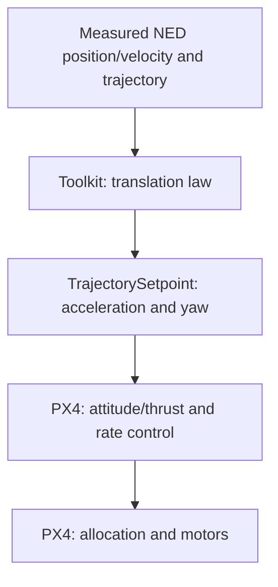

# Acceleration

The toolkit calculates position/velocity feedback and sends a **NED acceleration request** to PX4. PX4 converts it to attitude/thrust and runs its lower feedback loops and control allocation. This mode requires the least vehicle data: mass.



## Translation law

With $e_x=x-x_d$ and $e_v=v-v_d$ in NED:

$$
a_{\mathrm{cmd}}=a_d-\frac{k_x}{m}e_x-\frac{k_v}{m}e_v.
$$

The feedforward $a_d$ and the feedback terms are in m/s². If the vehicle is displaced north of its target, positive $e_x$ produces a southward correction. At a stationary hover with zero errors, the request is zero acceleration, not $-g e_3$. PX4 handles gravity compensation below this interface. The [foundations](foundations.md#translation-and-gravity-compensation) derive the force used by the other modes.

`kx_over_mass` and `kv_over_mass` are the configured gains; the runtime multiplies them by vehicle mass to obtain $k_x,k_v$. It checks that mass and gains are finite and positive.

## Messages and timing

Only `OffboardControlMode.acceleration` is true; the other control-level flags are false. The active `TrajectorySetpoint` contains:

| Field | Value |
|---|---|
| `acceleration` | $a_{\mathrm{cmd}}$, NED m/s² |
| `yaw` | Desired trajectory heading, rad |
| `position`, `velocity`, `jerk` | NaN on all axes |
| `yawspeed` | NaN |
| `timestamp` | Publication time in microseconds |

**NaN means unused.** Zero position or velocity would enable a different PX4 interpretation. The separately published `/se3/trajectory_reference` contains the full desired trajectory for analysis and is not this PX4 input.

The outer wall timer publishes at `control_rate_hz` (100 Hz by default) after Offboard confirmation. Readiness requires finite position/velocity plus all PX4 validity flags; attitude/rate state is not required for this mode. The shared [startup/return behavior](../se3.md#when-the-controller-starts-and-stops) applies.

## Run and inspect

With a prepared airborne SITL vehicle, matching mass file, and no competing controller, in a **separate repository-root shell**:

```bash
source ros2/runtime_env.sh
ros2 launch offboard_controllers se3.launch.py \
  vehicle:=gz_f450 trajectory:=line_tracking handoff:=acceleration \
  publish_diagnostics:=true record:=true
```

Inspect measured position/velocity against the trajectory, commanded acceleration, and downstream PX4 attitude/thrust. A nonzero tracking error may come from lower-loop response or saturation, not solely the translational gains. Mass-only availability does not validate a new physical airframe.

The calculation is in [translation.cpp](https://github.com/ANCL/px4-dev-toolkit/blob/main/ros2/src/offboard_controllers/src/se3/control/translation.cpp); exact fields are in [runtime/publication.cpp](https://github.com/ANCL/px4-dev-toolkit/blob/main/ros2/src/offboard_controllers/src/se3/runtime/publication.cpp), selected by [runtime/control.cpp](https://github.com/ANCL/px4-dev-toolkit/blob/main/ros2/src/offboard_controllers/src/se3/runtime/control.cpp).

Continue with [Attitude](attitude.md) to calculate the desired rotation in the toolkit.
