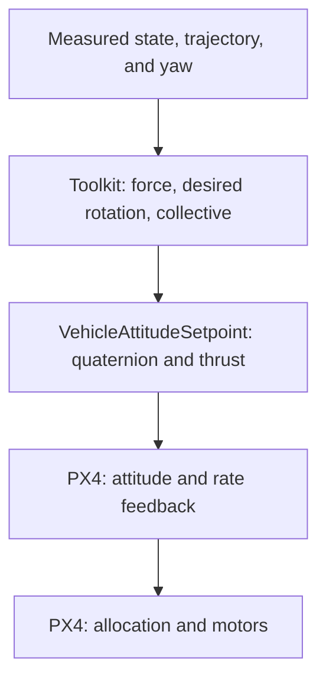

# Attitude

The toolkit calculates the desired rotation and collective thrust, then sends `VehicleAttitudeSetpoint`. PX4 calculates attitude feedback, rate feedback, and motor allocation. Unlike acceleration mode, this mode needs a curated vehicle hover-thrust scale.



## Force to rotation

Use the common translation errors and acceleration law:

$$
A=m(a_{\mathrm{cmd}}-g e_3),\qquad b_{3d}=-A/\|A\|.
$$

Desired heading $b_{1c}=(\cos\psi_d,\sin\psi_d,0)^\top$ fixes the remaining attitude:

$$
b_{2d}=\frac{b_{3d}\times b_{1c}}{\|b_{3d}\times b_{1c}\|},\quad
b_{1d}=b_{2d}\times b_{3d},\quad R_d=[b_{1d}\ b_{2d}\ b_{3d}].
$$

$R_d$ maps desired FRD axes into NED. The [foundations](foundations.md#desired-attitude-from-force-and-heading) explain degeneracy and the frame conventions. The runtime converts $R_d$ to a normalized scalar-first quaternion $q_d=(w,x,y,z)$, using trace/major-diagonal branches to avoid an unstable single formula near 180° rotations.

## Collective projection and message

Collective uses the **current** body axis, not the norm of desired force:

$$
f=-A^\top R e_3,\qquad
u_T=\operatorname{clip}_{[0,1]}\left(h f/(mg)\right).
$$

`VehicleAttitudeSetpoint.q_d` contains the FRD-to-NED quaternion. `thrust_body=(0,0,-u_T)` is dimensionless; negative FRD Z means upward thrust. `yaw_sp_move_rate` contains desired trajectory yaw rate in rad/s. Only `OffboardControlMode.attitude` is enabled.

Hover scale $h$ is `px4_allocator.hover_thrust` in the vehicle YAML. It is a calibration, not mass or a physical force constant. PX4's response also depends on its attitude/rate tuning and allocator configuration. Projection/clipping can reduce available force during attitude error; no direct toolkit rotational feedback law is executed in this mode.

## Timing, run, and diagnosis

Valid position/velocity and attitude are required. The outer timer (100 Hz by default) publishes after confirmed Offboard; jerk/snap are not needed to construct $R_d$ here. Shared [lifecycle behavior](../se3.md#when-the-controller-starts-and-stops) still applies.

In a **separate repository-root shell**, with a matching, already airborne SITL vehicle and no competing controller:

```bash
source ros2/runtime_env.sh
ros2 launch offboard_controllers se3.launch.py \
  vehicle:=gz_f450 trajectory:=line_tracking handoff:=attitude \
  publish_diagnostics:=true record:=true
```

Inspect desired versus measured attitude, force command, normalized collective, downstream rate commands, and motor limits. Missing hover data is rejected; do not borrow another vehicle's value to bypass that check. Zero-force/degenerate heading and the model limitations in foundations remain applicable.

Read [attitude_reference.cpp](https://github.com/ANCL/px4-dev-toolkit/blob/main/ros2/src/offboard_controllers/src/se3/control/attitude_reference.cpp), [wrench.cpp](https://github.com/ANCL/px4-dev-toolkit/blob/main/ros2/src/offboard_controllers/src/px4/wrench.cpp), and [publication.cpp](https://github.com/ANCL/px4-dev-toolkit/blob/main/ros2/src/offboard_controllers/src/se3/runtime/publication.cpp).

Continue with [Attitude rate](attitude-rate.md) to add toolkit attitude feedback.
