# Mathematical foundations

This chapter explains the conventions and calculations shared by the six SE(3) configurations. Equations describe the checked-in controller and its ideal rigid-body model. Code inspection establishes implementation correspondence; it does not establish measured flight performance or transfer an ideal stability proof to saturated PX4 interfaces.

## Frames, rotation, and units

The local world frame is **NED**: North, East, Down. The aircraft body frame is **FRD**: Forward, Right, Down. Both are right-handed. Position $x$ and velocity $v$ are in NED; angular velocity $\Omega$ is in the current FRD body frame. $R=[b_1\ b_2\ b_3]$ maps body vectors into NED, so $b_3=R e_3$ is the current body-down direction in world coordinates. Here $e_3=(0,0,1)^\top$.

*Frame schematic: gravity follows NED down; rotor force follows negative body Z. This is a coordinate drawing, not a measured aircraft pose.*

PX4 quaternions are scalar-first $(w,x,y,z)$ and represent the FRD-to-NED rotation. The conversion in [wrench.cpp](https://github.com/ANCL/px4-dev-toolkit/blob/main/ros2/src/offboard_controllers/src/px4/wrench.cpp) normalizes the quaternion and chooses a deterministic sign. ROS pose messages can use other conventions; the [motion-capture bridge](../../environments/hardware.md) performs the explicit conversion.

| Symbol | Meaning | Frame / units |
|---|---|---|
| $x,v$ | Measured position and velocity | NED; m, m/s |
| $x_d,v_d,a_d,j_d,s_d$ | Desired position through snap | NED; m through m/s⁴ |
| $\psi_d,\dot\psi_d,\ddot\psi_d$ | Desired yaw and derivatives | About NED down; rad, rad/s, rad/s² |
| $R,R_d$ | Actual/desired body-to-world rotation | Dimensionless |
| $\Omega,\Omega_d$ | Actual/desired attitude angular velocity | Current/desired FRD; rad/s |
| $m,J,g$ | Mass, body inertia, standard gravity | kg, FRD kg·m², 9.80665 m/s² |
| $A,f,M$ | Force vector, collective thrust, body moment | NED N, scalar N, FRD N·m |
| $h,u_T,\tau_n$ | Hover scale, collective magnitude, PX4 torque | Normalized, dimensionless |

Yaw comes from trajectory configuration, not an implicit measured-heading offset. An upward position change has negative NED Z.

## Rigid-body model

For parallel upward-thrust rotors, neglecting aerodynamic drag and other external forces:

$$
\dot x=v,\qquad m\dot v=m g e_3-fR e_3.
$$

Positive collective thrust $f$ acts opposite body down. At level hover, $f=mg$, so acceleration is zero. Rotation follows

$$
\dot R=R\widehat\Omega,\qquad
J\dot\Omega+\Omega\times(J\Omega)=M.
$$

The **hat** operator maps a vector $z$ to the skew matrix $\widehat z$ satisfying $\widehat z\,y=z\times y$. The **vee** operator reverses that map. Define $\operatorname{skew}(B)=(B-B^\top)/2$ for numerical skew extraction.

These are physical dynamics. A normalized PX4 thrust/torque command is not automatically the physical $f,M$ in these equations; a calibration or adapter connects the two.

## Translation and gravity compensation

Define tracking errors with **measured minus desired** sign:

$$
e_x=x-x_d,\qquad e_v=v-v_d.
$$

[translation.cpp](https://github.com/ANCL/px4-dev-toolkit/blob/main/ros2/src/offboard_controllers/src/se3/control/translation.cpp) calculates

$$
a_{\mathrm{cmd}}=a_d-\frac{k_x}{m}e_x-\frac{k_v}{m}e_v,
$$

then the gravity-compensated force vector

$$
A=m(a_{\mathrm{cmd}}-g e_3)
=-k_xe_x-k_ve_v-mg e_3+ma_d.
$$

$a_{\mathrm{cmd}}$ is a kinematic acceleration request in m/s². It excludes gravity at the PX4 acceleration interface. $A$ is in newtons and points upward at hover. The runtime uses scalar $k_x=m\,\texttt{kx\_over\_mass}$ and $k_v=m\,\texttt{kv\_over\_mass}$; their mass-normalized units are s⁻² and s⁻¹.

If attitude tracks the desired thrust direction exactly and thrust is feasible, the model gives $\dot v=a_{\mathrm{cmd}}$. With attitude error or actuator limits, it need not. This difference also matters in analytic feedforward.

## Desired attitude from force and heading

The desired body-down axis must point opposite the force:

$$
b_{3d}=-\frac{A}{\|A\|},\qquad
b_{1c}=(\cos\psi_d,\sin\psi_d,0)^\top.
$$

Construct a right-handed orthonormal basis:

$$
b_{2d}=\frac{b_{3d}\times b_{1c}}{\|b_{3d}\times b_{1c}\|},\qquad
b_{1d}=b_{2d}\times b_{3d},\qquad
R_d=[b_{1d}\ b_{2d}\ b_{3d}].
$$

$b_{1c}$ is the horizontal heading used to choose the remaining rotation about the thrust axis. When tilted, $b_{1d}$ is the compatible body-forward axis rather than an arbitrary independent horizontal vector. [attitude_reference.cpp](https://github.com/ANCL/px4-dev-toolkit/blob/main/ros2/src/offboard_controllers/src/se3/control/attitude_reference.cpp) rejects a force norm or cross-product norm at/below $10^{-12}$; zero force and parallel thrust/heading are singular. There is no hidden alternate heading solution.

## Analytic force derivatives

Desired jerk $j_d=x_d^{(3)}$ and snap $s_d=x_d^{(4)}$ come from the [trajectory sampler](../trajectories.md). The implemented force derivatives use **model acceleration and jerk**, avoiding finite differences of noisy acceleration estimates.

Project onto the **current** body axis:

$$
f=-A^\top b_3,\qquad
a_{\mathrm{model}}=g e_3-\frac{f}{m}b_3,
\qquad e_a=a_{\mathrm{model}}-a_d.
$$

Then

$$
\dot A=mj_d-k_x e_v-k_v e_a.
$$

For the second derivative, measured body angular velocity gives

$$
\dot b_3=R(\Omega\times e_3),\qquad
\dot f=-\dot A^\top b_3-A^\top\dot b_3,
$$

$$
j_{\mathrm{model}}=-\frac{\dot f}{m}b_3-\frac{f}{m}\dot b_3,
\qquad e_j=j_{\mathrm{model}}-j_d,
$$

and therefore

$$
\ddot A=ms_d-k_x e_a-k_v e_j.
$$

These expressions follow [force_dynamics.cpp](https://github.com/ANCL/px4-dev-toolkit/blob/main/ros2/src/offboard_controllers/src/se3/control/force_dynamics.cpp). They use the unconstrained projected thrust model, not measured motor thrust or the adapter's limited output. Their accuracy depends on that model and the state estimate.

## Differentiate the desired basis

The code applies the same analytic normalization rule to $-A$ and to $b_{3d}\times b_{1c}$. For any vector $z(t)$ with $\rho=\|z\|$ and $n=z/\rho$:

$$
\dot\rho=n^\top\dot z,\qquad
\dot n=\frac{\dot z-\dot\rho n}{\rho},
$$

$$
\ddot\rho=\frac{\dot z^\top\dot z+z^\top\ddot z-\dot\rho^2}{\rho},
\qquad
\ddot n=\frac{\ddot z-2\dot\rho\dot n-\ddot\rho n}{\rho}.
$$

The heading derivatives are

$$
\dot b_{1c}=\dot\psi_d(-\sin\psi_d,\cos\psi_d,0)^\top,
$$

$$
\ddot b_{1c}=\ddot\psi_d(-\sin\psi_d,\cos\psi_d,0)^\top
-\dot\psi_d^2(\cos\psi_d,\sin\psi_d,0)^\top.
$$

Product rules give the derivatives of $b_{3d}\times b_{1c}$ and then $b_{1d}=b_{2d}\times b_{3d}$. For example, a second cross-product derivative includes $2\dot b_{2d}\times\dot b_{3d}$. Assemble $\dot R_d$ and $\ddot R_d$ from those column derivatives.

Desired attitude angular velocity and acceleration are

$$
\Omega_d=\operatorname{vee}(\operatorname{skew}(R_d^\top\dot R_d)),\qquad
\dot\Omega_d=\operatorname{vee}(\operatorname{skew}(R_d^\top\ddot R_d)).
$$

The omitted $\dot R_d^\top\dot R_d$ term is symmetric, so it contributes nothing to vee/skew extraction. $\Omega_d$ is expressed in the **desired** body frame. It is the angular velocity of $R_d$ itself, not a feedback-corrected body-rate command. Attitude-rate/PX4-rate modes need first derivatives; the direct geometric laws also use second derivatives. No finite-difference attitude reference is used.

## Rotation errors and feedforward

Map desired-body vectors into the current FRD frame with $Q=R^\top R_d$:

$$
e_R=\frac12(R_d^\top R-R^\top R_d)^\vee,
\qquad e_\Omega=\Omega-Q\Omega_d.
$$

The time derivative of the mapped desired rate is

$$
\alpha_{\mathrm{ff}}=-\Omega\times(Q\Omega_d)+Q\dot\Omega_d.
$$

It is expressed in the current body frame in rad/s². The geometric torque laws use it; the cascaded attitude-to-rate law instead uses $Q\Omega_d$ plus attitude feedback. See [attitude_geometry.cpp](https://github.com/ANCL/px4-dev-toolkit/blob/main/ros2/src/offboard_controllers/src/se3/control/attitude_geometry.cpp).

The SO(3) error is smooth but does not uniquely distinguish the desired attitude from every 180° critical orientation. Singular desired bases, estimation errors, sampling, saturation, and mismatched plant/calibration remain real limitations.

## Physical and normalized collective thrust

The Lee-style projection uses the **current** attitude:

$$
f=-A^\top R e_3.
$$

For attitude, attitude-rate, geometric-normalized, and PX4-rate modes, the vehicle hover scale $h$ maps it to

$$
u_T=\operatorname{clip}_{[0,1]}\left(h\frac{f}{mg}\right),\qquad
\text{published thrust}_z=-u_T.
$$

At level hover, $u_T=h$. Projection is not $\|A\|$ unless thrust axes align; clipping discards impossible negative/over-range collective requests. The negative body-Z sign is correct in FRD. Physical mode uses its [propulsion/allocator adapter](geometric-physical.md), rather than this hover scale. Normalized torque cannot be interpreted as N·m without the relevant vehicle mapping.

## References and implementation

Taeyoung Lee, Melvin Leok, and N. Harris McClamroch, **“Geometric tracking control of a quadrotor UAV on SE(3)”**, CDC 2010, pp. 5420–5425, [DOI: 10.1109/CDC.2010.5717652](https://doi.org/10.1109/CDC.2010.5717652), provides the geometric error definitions (Eqs. 10–11) and physical moment law (Eq. 13). The toolkit's NED/FRD signs must be read with the equations above.

The code also identifies [FDCL geometric-control commit f5fcb51](https://github.com/fdcl-gwu/uav_geometric_control/tree/f5fcb51c3b962152a4895a9d2e86e4a184655741) for analytic basis/force derivatives. The toolkit's normalized law and physical-to-PX4 adapter are separate implementation choices; the original paper does not define those interfaces.

Continue with [Acceleration](acceleration.md), or select a mode in the [SE(3) introduction](../se3.md).
