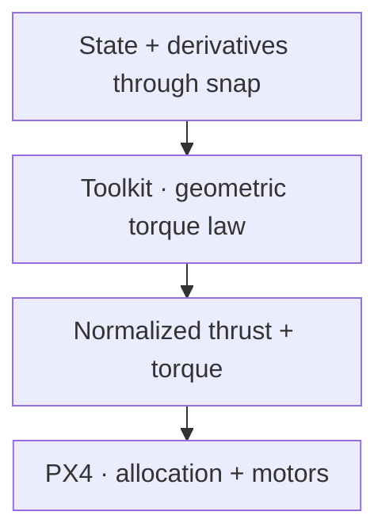

# Geometric normalized torque

This toolkit law uses geometric attitude/rate errors and analytic angular acceleration feedforward to calculate **normalized PX4 torque directly**. PX4 receives thrust and torque and performs allocation. This law does not calculate a physical inertia-based moment.



## Geometric errors

With $Q=R^\top R_d$, map desired-body rate to the current FRD body frame:

$$
\begin{aligned}
e_R&=\tfrac12(R_d^\top R-R^\top R_d)^\vee \\
e_\Omega&=\Omega-Q\Omega_d.
\end{aligned}
$$

Current-frame acceleration feedforward is

$$
\alpha_{\mathrm{ff}}=-\Omega\times(Q\Omega_d)+Q\dot\Omega_d.
$$

The [foundations](foundations.md#rotation-errors-and-feedforward) derive this from the moving frame. $\Omega_d$ is desired attitude angular velocity, not the feedback-corrected $\Omega_{\mathrm{sp}}$ used by cascaded rate modes.

## Implemented normalized law

The runtime adds three component-wise terms:

$$
\tau_n=-K_R^n e_R-K_\Omega^n e_\Omega+K_\alpha^n\alpha_{\mathrm{ff}}.
$$

`normalized_attitude_gain`, `normalized_angular_velocity_gain`, and `normalized_angular_acceleration_gain` are diagonal gains mapping into dimensionless normalized torque. Their dimensions are normalized torque per attitude error, per rad/s, and per rad/s² respectively. Thus $K_\Omega^n$ has a time factor and $K_\alpha^n$ a time-squared factor when radians are dimensionless.

The configured $K_R^n$ equals `attitude_gain` times $K_\Omega^n$ component-wise, but the runtime reads the normalized gains independently; it does not recompute that relation. The acceleration feedforward term is **not** PX4's derivative feedback term.

This is the repository's normalized geometric controller, not Lee 2010 Eq. (13) converted to normalized units. There is no inertia $J$, no gyroscopic moment $\Omega\times(J\Omega)$, and no output in N·m. Similar geometric errors do not make the two rotational laws physically equivalent.

## Thrust, messages, and timing

Collective uses mass and hover scale:

$$
\begin{aligned}
f&=-A^\top R e_3 \\
u_T&=\operatorname{clip}_{[0,1]}(h f/(mg)).
\end{aligned}
$$

`VehicleThrustSetpoint.xyz=(0,0,-u_T)` and `VehicleTorqueSetpoint.xyz=\tau_n` are in current FRD axes. They share publication time; this outer-loop publisher leaves `timestamp_sample` at its default. Only `OffboardControlMode.thrust_and_torque` is true.

The toolkit clips collective, but this normalized torque law has no explicit torque clamp or integral anti-windup. PX4 allocation still imposes actuator limits. Do not interpret a normalized coordinate as a guaranteed achieved physical torque.

Valid position/velocity, attitude, and body angular velocity are required. The outer timer (100 Hz by default) evaluates desired dynamics through snap and yaw acceleration, then publishes after confirmed Offboard. Read the shared [lifecycle](../se3.md#when-the-controller-starts-and-stops).

## Run and inspect

In a **separate repository-root shell**, with a matching, prepared airborne SITL vehicle and no competing controller:

```bash
source ros2/runtime_env.sh
ros2 launch offboard_controllers se3.launch.py \
  vehicle:=gz_f450 trajectory:=full_excitation handoff:=thrust_and_torque \
  direct_controller:=geometric_normalized publish_diagnostics:=true record:=true
```

Diagnostics separate attitude feedback, rate feedback, and acceleration feedforward. Inspect them beside the final torque, allocator residuals, and motors. Large commands during transients may be infeasible; absence of integral action does not remove saturation. The model and SO(3) limitations in foundations apply.

Read [normalized_torque.cpp](https://github.com/ANCL/px4-dev-toolkit/blob/main/ros2/src/offboard_controllers/src/se3/control/normalized_torque.cpp), [attitude_geometry.cpp](https://github.com/ANCL/px4-dev-toolkit/blob/main/ros2/src/offboard_controllers/src/se3/control/attitude_geometry.cpp), and [runtime/control.cpp](https://github.com/ANCL/px4-dev-toolkit/blob/main/ros2/src/offboard_controllers/src/se3/runtime/control.cpp). The [Lee citation](foundations.md#references-and-implementation) supports the error definitions; the normalized law is a toolkit choice.

Continue with [PX4 rate controller](px4-rate.md) for the sample-driven P/I/D alternative.
