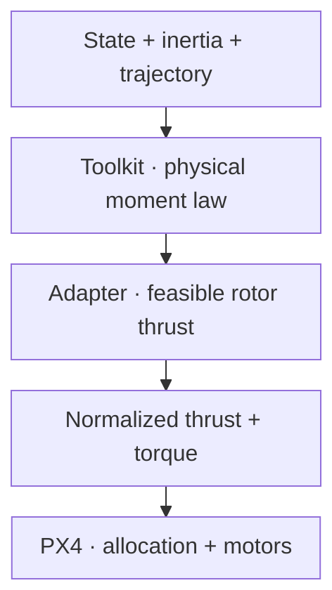

# Geometric physical moment

This mode calculates a **physical body moment in N·m** using a Lee-style rigid-body law. A separate toolkit adapter converts physical collective thrust and moment into normalized PX4 commands. PX4 then performs allocation; the original controller law does not define that conversion.



## Physical rotational law

Use the shared $Q=R^\top R_d$, $e_R$, $e_\Omega=\Omega-Q\Omega_d$, and

$$
\alpha_{\mathrm{ff}}=-\Omega\times(Q\Omega_d)+Q\dot\Omega_d.
$$

The FRD moment is

$$
\begin{aligned}
M&=-K_R e_R-K_\Omega e_\Omega \\
&\quad+\Omega\times(J\Omega)+J\alpha_{\mathrm{ff}}.
\end{aligned}
$$

$J$ is the symmetric positive-definite body inertia in kg·m². $K_R$ maps attitude error to N·m and $K_\Omega$ maps rad/s to N·m (N·m·s when radians are dimensionless). They are `geometric_physical_k_r` and `geometric_physical_k_omega` in controller tuning.

The gyroscopic term compensates $\Omega\times(J\Omega)$ in the rigid-body dynamics; $J\alpha_{\mathrm{ff}}$ supplies desired angular acceleration in current-body axes. This corresponds to Lee 2010 Eq. (13), with the [NED/FRD conventions and citation](foundations.md). Physical collective is

$$
f=-A^\top R e_3\quad[\mathrm N].
$$

It is projected onto the current body axis. The adapter rejects negative/non-finite requested collective. Neither $M$ nor $f$ is sent as a physical-valued PX4 wrench message.

## Physical rotor allocation

**The current adapter supports exactly four rotors.** It forms a square four-coordinate system for roll, pitch, yaw, and collective. A hexarotor cannot use it merely by adding vehicle YAML; generic N-rotor allocation requires an adapter implementation change.

For rotor $i$ with FRD arm $r_i=(x_i,y_i,z_i)$ relative to the center of mass, upward force is $(0,0,-T_i)$. Thus its arm moment is $(-y_iT_i,x_iT_i,0)$. Signed reaction ratio $\kappa_i$ adds yaw moment. Define

$$
\begin{aligned}
B_{\mathrm{phys},i}&=(-y_i,\ x_i,\ \kappa_i,\ 1)^\top \\
T&=B_{\mathrm{phys}}^{-1}(M_x,M_y,M_z,f)^\top.
\end{aligned}
$$

The loader converts FLU physical data to FRD and subtracts the center of mass. It maps `ccw` to positive and `cw` to negative reaction ratio according to its schema convention. This convention and rotor indexing must agree with the plant and PX4 mapping.

Each physical rotor uses the configured monotonic polynomial

$$
\begin{aligned}
T_i(u_i)&=c_0+c_1u_i+c_2u_i^2\quad[\mathrm N], \\
u_i&\in[u_{\min},u_{\max}]\subseteq[0,1].
\end{aligned}
$$

For the curated F450 fixture, the source-backed polynomial is $0.27+3.06u+8.67u^2$ N, derived from its pinned rotor-speed relation. It is fixture data, not a generic motor model.

## Feasible thrust and moment scaling

First clip collective to $4T_{\min}\le f_a\le4T_{\max}$. Compute a collective-only vector $T^0=B_{\mathrm{phys}}^{-1}(0,0,0,f_a)^\top$ and the requested vector $T^*=B_{\mathrm{phys}}^{-1}(M_x,M_y,M_z,f_a)^\top$.

Choose the largest feasible $\lambda\in[0,1]$ such that

$$
\begin{aligned}
T_i^a&=T_i^0+\lambda(T_i^*-T_i^0) \\
&\in[T_{\min},T_{\max}]\quad\text{for every rotor}.
\end{aligned}
$$

Positive rotor deltas bound $\lambda$ by $(T_{\max}-T_i^0)/(T_i^*-T_i^0)$; negative deltas bound it by $(T_i^0-T_{\min})/(T_i^0-T_i^*)$. An infeasible collective-only allocation throws rather than hiding invalid geometry. Uniform scaling preserves roll/pitch/yaw moment ratios: the applied modeled moment is $\lambda M$. This is a toolkit feasibility choice, not part of Lee's unconstrained law.

Invert the monotonic thrust polynomial on its configured interval to obtain $u_i$: a direct linear inverse when $c_2$ is negligible, otherwise the feasible quadratic root. These are modeled actuator controls, not measured rotor thrusts.

## Convert to PX4 normalized coordinates

The PX4 allocator matrix is distinct from the physical matrix. For upward FRD rotor axis and allocator coefficients $C_{T,i},K_{M,i}$:

$$
B_{\mathrm{PX4},i}=C_{T,i}(-y_i,\ x_i,\ K_{M,i},\ -1)^\top.
$$

The negative fourth row represents **body-Z thrust**, whereas the physical matrix's fourth row represents positive collective. Allocator geometry/coefficient values can differ from physical propulsion geometry and must match the actual PX4 airframe.

The adapter reproduces the pinned pseudo-inverse normalization. Let $L=B_{\mathrm{PX4}}^{-1}$. Roll/pitch scales use the larger column norm divided by $\sqrt{n/2}$, where $n$ counts entries above $10^{-3}$; yaw uses the maximum yaw mixer entry; thrust uses mean absolute nonzero thrust-column magnitude. Collect these scales in diagonal $S$. Then

$$
c_n=S B_{\mathrm{PX4}}u.
$$

The first three coordinates are normalized torque, and the fourth is normalized thrust Z. With the corresponding normalized mixer $L S^{-1}$, the algebra reconstructs the selected actuator vector $u$. It depends on matching the pinned allocator normalization, rotor order, airframe type, and actuator model; different PX4 allocation behavior invalidates that correspondence.

## Parameters, timing, and messages

Required data includes mass, center of mass, FRD-convertible inertia, four rotor positions/directions, moment ratio, actuator polynomial/range, and FRD PX4 allocator geometry/coefficients for airframe type 0. **Hover-thrust calibration is not used by this path.** F450 is the curated reference fixture; another compatible quadrotor can be added with verified data.

Valid position/velocity, attitude, and body rate are required. The outer timer computes analytic attitude dynamics through desired snap/yaw acceleration and publishes the adapted wrench (100 Hz default) after Offboard confirmation. Only `OffboardControlMode.thrust_and_torque` is true. Both wrench messages share publication time; `timestamp_sample` remains default for this outer-loop path. Shared [startup/return behavior](../se3.md#when-the-controller-starts-and-stops) applies.

In a **separate repository-root shell**, with the prepared airborne F450 simulation and no competing controller:

```bash
source ros2/runtime_env.sh
ros2 launch offboard_controllers se3.launch.py \
  vehicle:=gz_f450 trajectory:=full_excitation handoff:=thrust_and_torque \
  direct_controller:=geometric_physical publish_diagnostics:=true record:=true
```

Diagnostics show requested/applied modeled collective, requested moment, $\lambda M$, and moment scale. A scale below one means the adapter limited the modeled wrench; it does not measure achieved aircraft moment. Physical model error, saturation, singular allocation matrices, and SO(3) critical attitudes remain limitations.

Read [physical_moment.cpp](https://github.com/ANCL/px4-dev-toolkit/blob/main/ros2/src/offboard_controllers/src/se3/control/physical_moment.cpp), [adapter.cpp](https://github.com/ANCL/px4-dev-toolkit/blob/main/ros2/src/offboard_controllers/src/se3/physical_wrench/adapter.cpp), [matrices.cpp](https://github.com/ANCL/px4-dev-toolkit/blob/main/ros2/src/offboard_controllers/src/se3/physical_wrench/matrices.cpp), [actuators.cpp](https://github.com/ANCL/px4-dev-toolkit/blob/main/ros2/src/offboard_controllers/src/se3/physical_wrench/actuators.cpp), and the [vehicle loader](https://github.com/ANCL/px4-dev-toolkit/blob/main/ros2/src/offboard_controllers/src/se3/physical_wrench/config/loader.cpp). The normalization follows pinned PX4 [ControlAllocationPseudoInverse.cpp](https://github.com/ANCL/PX4-Autopilot/blob/f5083ca2c5b919350880e8667e636ef70715db17/src/lib/control_allocation/control_allocation/ControlAllocationPseudoInverse.cpp).

Continue with [Trajectories](../trajectories.md) to connect analytic references to experiments.
