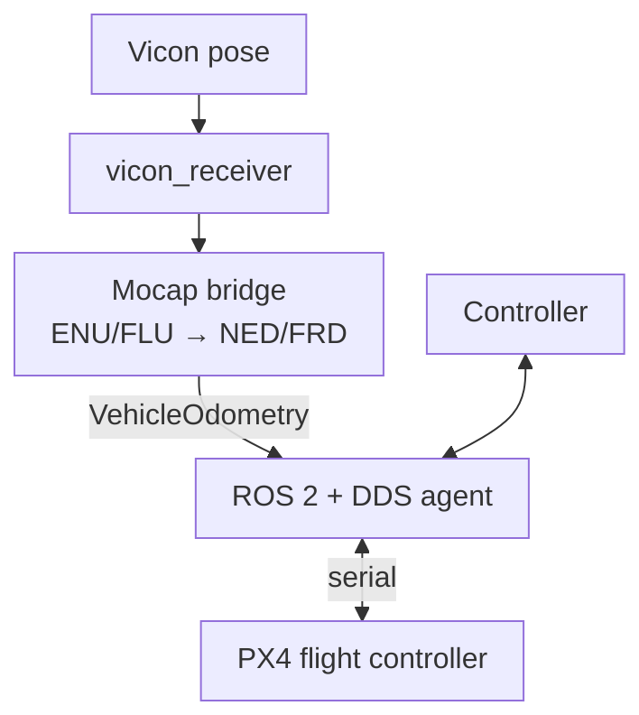

<!-- Preserve existing section links. -->
<span id="hardware-environment"></span>

# Physical hardware

On a physical vehicle, PX4 firmware is already running on the flight controller. A **companion computer** runs the toolkit's ROS 2 services and communicates with PX4 over serial. Install the native `hardware` profile; the maintained Docker image supports SITL.

<!-- Preserve existing section links. -->
<span id="vicon-and-mocap-path"></span>

## Runtime architecture



**Vicon** is the motion-capture system supplying the aircraft pose. The bridge converts ROS east-north-up (ENU) world coordinates and forward-left-up (FLU) body orientation to PX4 north-east-down (NED) and forward-right-down (FRD). It normalizes the quaternion and publishes pose through `VehicleOdometry`. The input contains pose only: velocity, angular velocity, and variance fields are marked unavailable with NaN. Sample time uses a valid source header when configured, otherwise publication time. See the [conversion source](https://github.com/ANCL/px4-dev-toolkit/blob/main/ros2/src/px4_mocap_bridge/src/conversion.cpp).

<!-- Preserve existing section links. -->
<span id="cli"></span>

## What starts

From the **companion-computer repository root**:

```bash
./tools/hardware start
```

The default session is `px4-hardware`:

| tmux window | Service |
|---|---|
| `mocap` | Vicon reception plus `px4_mocap_bridge`, through `mocap.launch.py` |
| `xrce-dds` | Serial Micro XRCE-DDS Agent when `START_XRCE_AGENT=true` (current default) |

Starting again attaches to the existing session. Use **Ctrl-b, then d** to detach. The [launcher](https://github.com/ANCL/px4-dev-toolkit/blob/main/tools/hardware) does not start firmware, arm, fly, launch Position-mode scripts or an Offboard controller, or begin recording.

In physical flight, the pilot controls Position mode with a **real RC transmitter or joystick**. The MAVProxy virtual joystick supplies simulated manual input for the SITL examples.

<!-- Preserve existing section links. -->
<span id="start-checklist"></span>

## Runtime configuration

Use [config/runtime/hardware.env](https://github.com/ANCL/px4-dev-toolkit/blob/main/config/runtime/hardware.env) for the actual serial device/baud, Vicon host, object topic, frame names, world transform, and timestamp behavior. These are site-specific values; the checked-in examples are not universal lab settings. The wrapper currently requires `serial` transport when it starts the agent.

Before starting services, check the device exists and is accessible, the serial settings match PX4's XRCE client, the Vicon server is reachable, and the selected rigid body and coordinate transform describe the aircraft you intend to use.

## What status means

In a **second companion shell at the repository root**:

```bash
source ros2/runtime_env.sh
./tools/hardware status
ros2 topic list
```

Inspect the Vicon pose and converted odometry on the configured topics, then verify PX4's estimator response. A running tmux session or agent is a service check; it is not proof of a flight-ready vehicle.

<!-- Preserve existing section links. -->
<span id="next"></span>

## Pre-flight requirements

On the actual platform, check estimator/external-vision configuration and frame alignment, sensor health, airframe selection, actuator ordering, vehicle data, controller compatibility, RC and failsafe behavior, and independent emergency actions. Do not correct a wrong motion-capture transform through controller gains.

Stop the companion services **only after flight has ended and their removal is appropriate**:

```bash
./tools/hardware stop
```

This command stops companion services; it is not a landing or disarm command. Continue with [controller choices](../controllers/overview.md) and [vehicle requirements](../reference/adding-a-vehicle.md).
