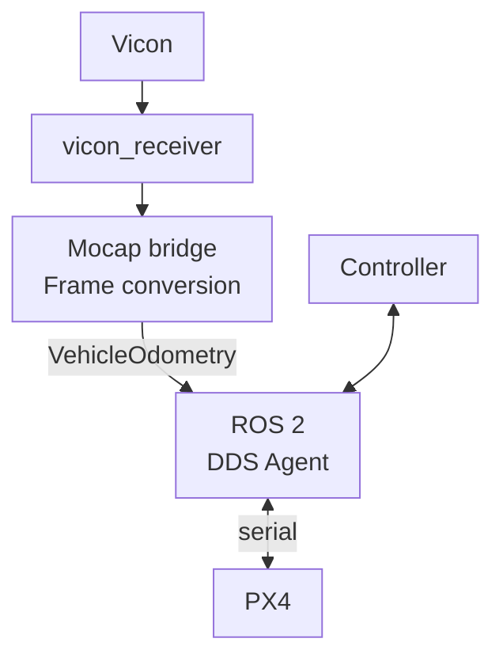

<!-- Preserve existing section links. -->
<span id="hardware-environment"></span>
<span id="physical-hardware"></span>

# Companion Computer

PX4 firmware runs on the aircraft's flight controller. The companion computer
runs ROS 2 services and communicates with PX4 over a serial link. Follow
[Companion Computer installation](../installation/companion.md) for the native
`hardware` profile. The maintained Docker image supports SITL only.

<!-- Preserve existing section links. -->
<span id="vicon-and-mocap-path"></span>
<span id="runtime-architecture"></span>

## Architecture



**Vicon** supplies the aircraft's measured pose. The bridge converts ROS
east-north-up (ENU) world coordinates and forward-left-up (FLU) body
orientation to PX4 north-east-down (NED) and forward-right-down (FRD).
It normalizes the quaternion and publishes `VehicleOdometry`. The input
contains pose only: velocity, angular velocity, and variance fields are
marked unavailable with NaN. Sample time uses a valid source header when
configured, otherwise publication time. See the
[conversion source](https://github.com/ANCL/px4-dev-toolkit/blob/main/ros2/src/px4_mocap_bridge/src/conversion.cpp).

<!-- Preserve existing section links. -->
<span id="start-checklist"></span>
<span id="runtime-configuration"></span>

## Configure

Use [config/runtime/hardware.env](https://github.com/ANCL/px4-dev-toolkit/blob/main/config/runtime/hardware.env)
for the actual serial device and baud rate, Vicon server and object topic,
frame names, world transform, and timestamp behavior. These are site-specific
settings; the checked-in examples are not universal lab settings. The launcher
requires `serial` transport when it starts the agent.

Before starting, check that the serial device exists and is accessible, its
settings match PX4's XRCE client, the Vicon server is reachable, and the
selected rigid body and coordinate transform describe the intended aircraft.

<!-- Preserve existing section links. -->
<span id="cli"></span>
<span id="what-starts"></span>

## Start

From the **companion-computer repository root**:

```bash
./tools/hardware start
```

The default `px4-hardware` tmux session contains the following services:

- `mocap` — Vicon reception and `px4_mocap_bridge`, via `mocap.launch.py`.
- `xrce-dds` — serial Micro XRCE-DDS Agent, when `START_XRCE_AGENT=true`
  (the current default).

Starting again attaches to the existing session. Use **Ctrl-b, then d**
to detach. The [launcher](https://github.com/ANCL/px4-dev-toolkit/blob/main/tools/hardware)
does not start PX4 firmware, arm, launch a flight, launch an Offboard
controller, or begin recording.

In aircraft operation, Position mode normally uses the pilot's RC transmitter
or joystick. MAVProxy's virtual joystick provides simulated input for the
SITL examples, not a substitute for the aircraft's own pilot controls.

<!-- Preserve existing section links. -->
<span id="what-status-means"></span>

## Inspect

In a **second companion shell at the repository root**:

```bash
source ros2/runtime_env.sh
./tools/hardware status
ros2 topic list
```

Inspect the Vicon pose and converted odometry on the configured topics,
then verify PX4's estimator response. A running tmux session or agent is
only a service check, not proof that the aircraft is flight-ready.

<!-- Preserve existing section links. -->
<span id="next"></span>
<span id="pre-flight-requirements"></span>

## Before flight

On the actual aircraft, check estimator/external-vision configuration and
frame alignment, sensor health, airframe selection, actuator ordering,
vehicle data, controller compatibility, RC and failsafe behavior, and
independent emergency actions. Do not compensate for an incorrect
motion-capture transform by changing controller gains.

Stop the companion services **only after flight has ended** and doing so
will not interrupt required communication:

```bash
./tools/hardware stop
```

This stops companion services; it is not a landing or disarm command.
Continue with the [controller overview](../controllers/overview.md) and
[vehicle requirements](../reference/adding-a-vehicle.md).
