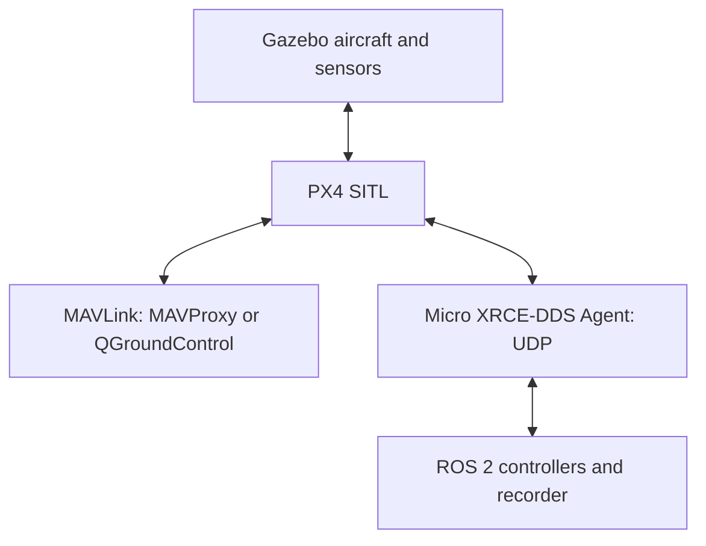

# Running SITL

**SITL** runs PX4 flight software on the workstation while **Gazebo** simulates the aircraft and its sensors. The launcher starts the environment services; controller launches are separate.

## How the parts connect



MAVLink carries ground-control messages. uXRCE-DDS connects PX4 to ROS 2 through the agent, so ROS nodes can receive state and send setpoints. A **setpoint** is the requested value, such as a position or body rate, that a controller tries to reach.

## Start, inspect, and stop

After [installation](../installation/index.md), in a **repository-root shell**:

```bash
./tools/sitl start
```

The default `px4-sitl` tmux session contains:

| Window | Process |
|---|---|
| `px4` | PX4 build/launch and Gazebo connection |
| `xrce-dds` | DDS agent, if `START_XRCE_AGENT=true` |
| `mavproxy` or `qgroundcontrol` | Configured ground-control frontend |

The launcher attaches to tmux. Starting again attaches to the existing session instead of creating another stack. **Ctrl-b, then d** detaches; **Ctrl-b, then n** changes windows. Open another shell for manual ROS commands.

For **headless Gazebo**, use this command instead of the GUI start:

```bash
./tools/sitl start headless
```

Headless changes Gazebo presentation only. The simulator server, PX4, DDS, and configured GCS still run. A graphical QGroundControl configuration still needs a display.

In a **second repository-root shell**:

```bash
source ros2/runtime_env.sh
./tools/sitl status
./tools/topic_rates
```

Status reports tmux and processes, including components that may have detached. The rate tool checks arriving ROS messages. It does not arm or launch a controller. Stop its display with Ctrl-C.

After the aircraft is landed and disarmed, in a **repository-root shell**:

```bash
./tools/sitl stop
```

The wrapper shuts down the tmux process trees, then searches for Gazebo processes associated with this repository. Use it instead of killing tmux alone.

## Current default runtime

[config/runtime/sitl.env](https://github.com/ANCL/px4-dev-toolkit/blob/main/config/runtime/sitl.env) selects the PX4 target, `gz_f450` model, world, estimator overrides, UDP DDS endpoint, optional agent, GCS, and session. The checked-in estimator settings enable external-vision/Gazebo odometry aiding and disable the other listed aiding sources. Changing these settings is a vehicle/estimator decision, not controller tuning.

The current launcher accepts `GCS=mavproxy` or `GCS=qgc`; there is no `none` option. MAVProxy loads the toolkit virtual joystick, which reproduces manual input for repeatable simulation takeoff/staging examples. Other controllers can work without that input when the aircraft is already prepared. QGroundControl requires the optional installation described in the [native guide](../installation/native.md).

Controller gains and trajectories live in their own files. Starting SITL does not arm, start Offboard control, or record a bag. Continue with [First simulation](../getting-started/first-simulation.md) or the [controller overview](../controllers/overview.md).
