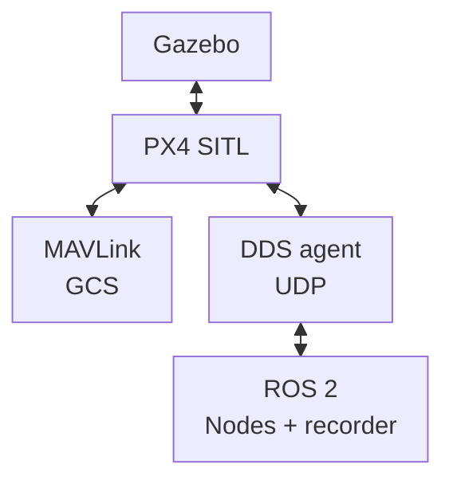

<!-- Preserve existing section links. -->
<span id="sitl-environment"></span>

<span id="running-sitl"></span>

# SITL

**SITL** runs PX4 flight software on the workstation while **Gazebo** simulates the aircraft and its sensors. The launcher starts the environment services; controller launches are separate.

<!-- Preserve existing section links. -->
<span id="what-the-launcher-owns"></span>

## How the parts connect



MAVLink carries ground-control messages. uXRCE-DDS connects PX4 to ROS 2 through the agent, so ROS nodes can receive state and send setpoints. A **setpoint** is the requested value, such as a position or body rate, that a controller tries to reach.

<!-- Preserve existing section links. -->
<span id="cli"></span>
<span id="start-with-gazebo-gui"></span>
<span id="start-without-gazebo-gui"></span>
<span id="inspect-status"></span>
<span id="stop"></span>
<span id="ros-2-connectivity"></span>

<span id="start-inspect-and-stop"></span>

## Start

After [installation](../installation/index.md), in a **repository-root shell**:

```bash
./tools/sitl start
```

The default `px4-sitl` tmux session contains:

- `px4` — PX4 build/launch and Gazebo connection.
- `xrce-dds` — DDS agent, if `START_XRCE_AGENT=true`.
- `mavproxy` or `qgroundcontrol` — the configured ground-control frontend.

The launcher attaches to tmux. Starting again attaches to the existing session instead of creating another stack. **Ctrl-b, then d** detaches; **Ctrl-b, then n** changes windows. Open another shell for manual ROS commands.

For **headless Gazebo**, use this command instead of the GUI start:

```bash
./tools/sitl start headless
```

Headless changes Gazebo presentation only. The simulator server, PX4, DDS, and configured GCS still run. A graphical QGroundControl configuration still needs a display.

## Inspect

In a **second repository-root shell**:

```bash
source ros2/runtime_env.sh
./tools/sitl status
./tools/topic_rates
```

Status reports tmux and processes, including components that may have detached. The rate tool checks arriving ROS messages. It does not arm or launch a controller. Stop its display with Ctrl-C.

<!-- Preserve existing section links. -->
<span id="ground-control-frontend"></span>
<span id="typical-controller-workflow"></span>
<span id="configuration-boundary"></span>
<span id="next"></span>


<span id="land-and-reset-the-simulated-vehicle"></span>

## Land and reset

Use this procedure **only in the documented MAVProxy SITL environment**, after the controller has completed and PX4 has confirmed its return to Position mode. It supplies the operator controls needed between separate Offboard demonstrations and before environment shutdown.

In a **repository-root shell in the running simulation environment** (inside the container when using Docker), attach to the session:

```bash
tmux attach-session -t px4-sitl
```

Press **Ctrl-b, then w** and select `mavproxy`. At the **MAVProxy console**, enter this command, not a Bash command:

```{ .text .copy }
mode LAND
```

MAVProxy resolves PX4's `LAND` mode and requests it over MAVLink. Verify the mode change in console/PX4 telemetry; watch the descent and wait for ground contact. If the request is rejected or the vehicle does not descend as expected, inspect the state/logs before proceeding. This command is not an instantaneous landing or disarm.

In a **second repository-root shell**, verify PX4's landing state:

```bash
source ros2/runtime_env.sh
ros2 topic echo /fmu/out/vehicle_land_detected --qos-reliability best_effort --once
ros2 topic echo /fmu/out/vehicle_status_v1 --qos-reliability best_effort --once
```

Require `landed: true`. Check arming state as well: `ARMING_STATE_DISARMED` is **1** in the pinned message. PX4 may disarm automatically; if it remains armed **after landed is confirmed**, return to the **MAVProxy console** and enter:

```{ .text .copy }
disarm
```

Check `/fmu/out/vehicle_status_v1` again and require disarmed state before stopping SITL or beginning another staging demonstration. Do not disarm an airborne vehicle. Once landed/disarmed, the staging helper can prepare a new flight; restore/restart the simulator if a failed experiment left an unsuitable starting state.

These operator commands are verified in pinned MAVProxy [mode handling](https://github.com/ArduPilot/MAVProxy/blob/932f6945cfc7fbc6579e166667d43e327fe44f2d/MAVProxy/modules/mavproxy_mode.py) and [disarm handling](https://github.com/ArduPilot/MAVProxy/blob/932f6945cfc7fbc6579e166667d43e327fe44f2d/MAVProxy/modules/mavproxy_arm.py). Check the actual mode, landing, and arming state after each request.

## Stop

After the aircraft is landed and disarmed, in a **repository-root shell**:

```bash
./tools/sitl stop
```

The wrapper shuts down the tmux process trees, then searches for Gazebo processes associated with this repository. Use it instead of killing tmux alone.

<span id="current-default-runtime"></span>

## Configuration

[config/runtime/sitl.env](https://github.com/ANCL/px4-dev-toolkit/blob/main/config/runtime/sitl.env) selects the PX4 target, `gz_f450` model, world, estimator overrides, UDP DDS endpoint, optional agent, GCS, and session. The checked-in estimator settings enable external-vision/Gazebo odometry aiding and disable the other listed aiding sources. Changing these settings is a vehicle/estimator decision, not controller tuning.

The current launcher accepts `GCS=mavproxy` or `GCS=qgc`; there is no `none` option. MAVProxy loads the toolkit virtual joystick, which reproduces manual input for repeatable simulation takeoff/staging examples. Other controllers can work without that input when the aircraft is already prepared. QGroundControl requires the optional installation described in the [native guide](../installation/native.md).

Controller gains and trajectories live in their own files. Starting SITL does not arm, start Offboard control, or record a bag. Continue with [First simulation](../getting-started/first-simulation.md) or the [controller overview](../controllers/overview.md).
