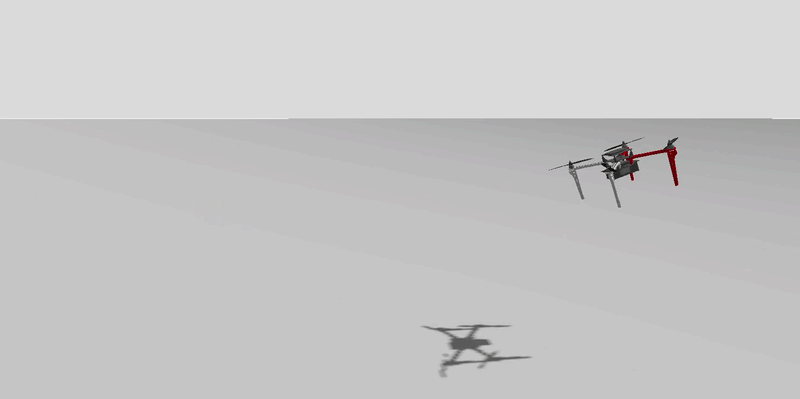
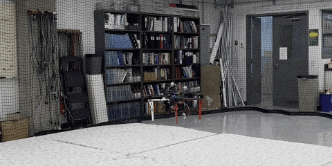

---
hide:
  - toc
---

  <section class="px4-home-intro" aria-labelledby="px4-development-toolkit">
    <h1 id="px4-development-toolkit">PX4 Development Toolkit</h1>
    
A development environment for PX4 and ROS 2, supporting controller experiments in Gazebo simulation and on physical aircraft.

    
Start with a simulation, choose where your controller runs, then record and analyze an experiment. Follow the operational guides at the terminal or work through the shared dynamics and geometric-control derivation.

    

      <a href="installation/" class="md-button md-button--primary">Get started</a>
      <a href="controllers/overview/" class="px4-home-secondary">Explore controllers →</a>
    

  </section>

  <section class="px4-home-media" aria-label="Simulation and physical-flight illustrations">
    

      <figure class="px4-home-media-item">
        

          
        

        <figcaption><strong>Gazebo SITL</strong>Circular trajectory in Gazebo SITL</figcaption>
      </figure>
      <figure class="px4-home-media-item">
        

          
        

        <figcaption><strong>Physical experiment</strong>Circular trajectory in the laboratory</figcaption>
      </figure>
    

  </section>

  <!-- Preserve links to sections from the earlier documentation homepage. -->
  
  
  
  
  
  
  
  

  <section class="px4-home-docs" aria-labelledby="documentation">
    <h2 id="documentation">Documentation</h2>
    <nav class="px4-home-directory" aria-label="Documentation sections">
      <a href="installation/" class="px4-home-doc-link">Get started ↗Installation and first simulation</a>
      <a href="operations/tools/" class="px4-home-doc-link">Using the toolkit ↗SITL, companion setup, onboard and Offboard workflows</a>
      <a href="controllers/overview/" class="px4-home-doc-link">Controllers ↗PX4 reference, Offboard, and onboard controllers</a>
      <a href="mathematics/geometric-control/" class="px4-home-doc-link">Mathematics ↗Frames, rigid-body dynamics, and geometric SE3 control</a>
      <a href="experiments/complete-example/" class="px4-home-doc-link">Experiments ↗Define motion, record data, and compare observed behavior</a>
      <a href="reference/architecture/" class="px4-home-doc-link">Reference ↗Architecture, configuration, and troubleshooting</a>
    </nav>
  </section>

