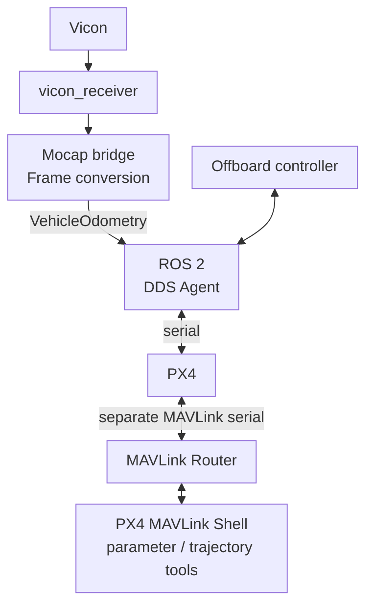

<!-- Preserve existing section links. -->
<span id="hardware-environment"></span>
<span id="physical-hardware"></span>

<span id="companion-computer"></span>

<span id="running-a-companion-computer"></span>

# Companion computer

The companion runs Vicon, ROS 2, DDS, and MAVLink services for a physical PX4 flight controller. Install the [hardware profile](../get-started/companion.md) first.

<!-- Preserve existing section links. -->
<span id="vicon-and-mocap-path"></span>
<span id="runtime-architecture"></span>

## Architecture



**Vicon** supplies the aircraft's measured pose. The bridge converts ROS
east-north-up (ENU) world coordinates and forward-left-up (FLU) body
orientation to PX4 north-east-down (NED) and forward-right-down (FRD).
It normalizes the quaternion and publishes `VehicleOdometry`. The input
contains pose only: velocity, angular velocity, and variance fields are
marked unavailable with NaN. Sample time uses a nonzero source header timestamp when
configured, otherwise publication time. See the
[conversion source](https://github.com/ANCL/px4-dev-toolkit/blob/main/ros2/src/px4_mocap_bridge/src/conversion.cpp).

<!-- Preserve existing section links. -->
<span id="start-checklist"></span>
<span id="runtime-configuration"></span>

## Configure

Use [config/runtime/hardware.env](https://github.com/ANCL/px4-dev-toolkit/blob/main/config/runtime/hardware.env)
for the actual serial device and baud rate, Vicon server and object topic,
frame names, world transform, and timestamp behavior. Set these values for your laboratory and aircraft. The launcher
requires `serial` transport when it starts the agent. Configure
`MAVLINK_MASTER` and `MAVLINK_BAUD` for a separate PX4 MAVLink device; the router
rejects use of the same device as DDS. `MAVLINK_QGC_OUT` optionally forwards to
a QGroundControl UDP destination. Ground control is started independently.

Before starting, check that both serial devices exist and are accessible, the
DDS settings match PX4's XRCE client, the Vicon server is reachable, and the
selected rigid body and coordinate transform describe the intended aircraft.

<!-- Preserve existing section links. -->
<span id="cli"></span>
<span id="what-starts"></span>

## Start

From the **companion-computer repository root**:

```bash
./tools/hardware start
```

The default `px4-hardware` tmux session contains the following services:

- `mocap` — Vicon reception and `px4_mocap_bridge`, via `mocap.launch.py`.
- `xrce-dds` — serial Micro XRCE-DDS Agent, when `START_XRCE_AGENT=true`
  (the current default).
- `mavlink-router` — dedicated MAVLink connection to PX4, independent of DDS.
- `px4-shell` — interactive PX4 MAVLink Shell through the router.

`start` attaches to the existing session if present; detaching leaves services running. The [launcher](https://github.com/ANCL/px4-dev-toolkit/blob/main/tools/hardware) starts mocap and communication services.

The `px4-shell` window is a **PX4 command terminal**, not Ubuntu Bash. Commands
there act on the connected flight controller. The router uses local UDP port
14661 for this shell and 14662 for parameter/trajectory tools. See [Tools and terminals](tools.md).


<!-- Preserve existing section links. -->
<span id="what-status-means"></span>

## Inspect

In a **second companion shell at the repository root**:

```bash
source ros2/runtime_env.sh
./tools/hardware status
ros2 topic list
```

Inspect Vicon pose, converted odometry, PX4 estimator state, and the `px4-shell` connection.

<!-- Preserve existing section links. -->
<span id="next"></span>
<span id="pre-flight-requirements"></span>

## Before flight

Before physical flight, check external-vision alignment, estimator and sensor health, airframe/actuator configuration, controller compatibility, pilot control, failsafes, and recovery procedures.

Stop the companion services **only after flight has ended** and doing so
will not interrupt required communication:

```bash
./tools/hardware stop
```

Continue with [Onboard control](onboard.md),
[Offboard control](offboard.md), and
[vehicle requirements](../extending/vehicles.md).
