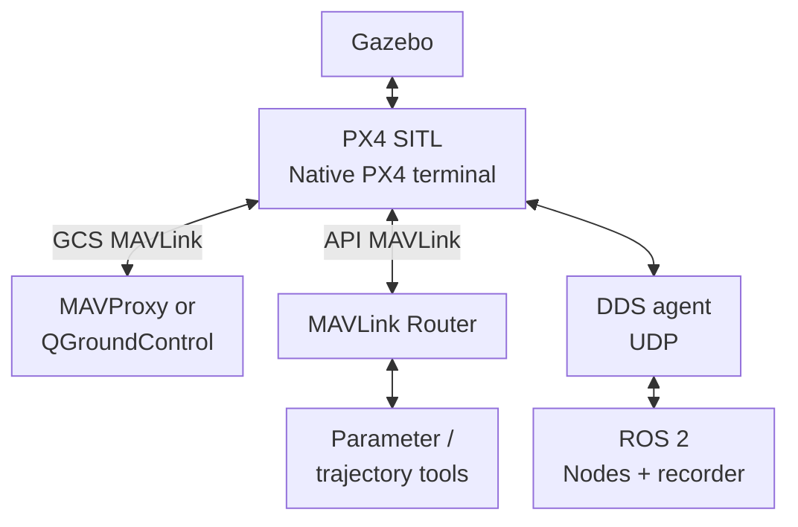

<!-- Preserve existing section links. -->
<span id="sitl-environment"></span>


<span id="sitl"></span>

<span id="running-sitl"></span>

# SITL

**SITL** runs PX4 on the workstation with Gazebo simulating the aircraft and sensors.

<!-- Preserve existing section links. -->
<span id="what-the-launcher-owns"></span>

## How the parts connect



MAVLink serves ground control, parameter transfers, and trajectory uploads. uXRCE-DDS transports ROS state and setpoints. [Tools](tools.md) identifies the command environments.

<!-- Preserve existing section links. -->
<span id="cli"></span>
<span id="start-with-gazebo-gui"></span>
<span id="start-without-gazebo-gui"></span>
<span id="inspect-status"></span>
<span id="ros-2-connectivity"></span>

<span id="start-inspect-and-stop"></span>

## Start

After [installation](../get-started/index.md), in a **repository-root shell**:

```bash
./tools/sitl start
```

The default `px4-sitl` tmux session contains:

- `px4` — PX4 build/launch and Gazebo connection.
- `xrce-dds` — DDS agent, if `START_XRCE_AGENT=true`.
- `mavproxy` or `qgroundcontrol` — the configured ground-control frontend.
- `mavlink-router` — independent MAVLink transport for parameter, trajectory, and shell tools.

`start` attaches to the tmux session and reattaches if it is already running. Open another repository shell for ROS commands.

For **headless Gazebo**, use this command instead of the GUI start:

```bash
./tools/sitl start headless
```

Headless mode still runs Gazebo simulation, PX4, DDS, and the configured GCS; QGroundControl requires a display.

## Inspect

In a **second repository-root shell**:

```bash
source ros2/runtime_env.sh
./tools/sitl status
./tools/topic_rates
```

`status` reports services and session windows; inspect `mavlink-router` directly if file transfers fail. `topic_rates` measures ROS callback arrivals after a 1-second warmup, not controller execution frequency.

<!-- Preserve existing section links. -->
<span id="ground-control-frontend"></span>
<span id="typical-controller-workflow"></span>
<span id="configuration-boundary"></span>
<span id="next"></span>


<span id="land-and-reset-the-simulated-vehicle"></span>

## Land and reset

For `GCS=mavproxy`, land after PX4 has returned to Position mode.

In a **repository-root shell in the running simulation environment** (inside the container when using Docker), attach to the session:

```bash
tmux attach-session -t px4-sitl
```

Open the `mavproxy` window in that session. At the **MAVProxy console**, enter this command, not a Bash or PX4 command:

```{ .text .copy }
mode LAND
```

Confirm PX4 accepted LAND, monitor descent, and wait for ground contact before disarming.

In a **second repository-root shell**, verify PX4's landing state:

```bash
source ros2/runtime_env.sh
ros2 topic echo /fmu/out/vehicle_land_detected --qos-reliability best_effort --once
ros2 topic echo /fmu/out/vehicle_status_v1 --qos-reliability best_effort --once
```

Require `landed: true`. Check arming state as well: `ARMING_STATE_DISARMED` is **1** in the pinned message. PX4 may disarm automatically; if it remains armed **after landed is confirmed**, return to the **MAVProxy console** and enter:

```{ .text .copy }
disarm
```

Confirm disarmed state in `/fmu/out/vehicle_status_v1` before starting another demonstration or stopping SITL. Never disarm in flight.

## Stop

After the aircraft is landed and disarmed, in a **repository-root shell**:

```bash
./tools/sitl stop
```

The wrapper shuts down the tmux process trees, then searches for Gazebo processes associated with this repository. Use it instead of killing tmux alone.

<span id="current-default-runtime"></span>

## Configuration

[config/runtime/sitl.env](https://github.com/ANCL/px4-dev-toolkit/blob/main/config/runtime/sitl.env) selects the PX4 target, `gz_f450` model, world, estimator overrides, UDP DDS endpoint, optional agent, GCS, and session. The checked-in estimator settings enable external-vision/Gazebo odometry aiding and disable the other listed aiding sources. Changing these settings is a vehicle/estimator decision, not controller tuning.

`GCS` accepts `mavproxy` or `qgc`. The staging and Position-mode examples use MAVProxy's virtual joystick. QGroundControl installation is covered in [Native SITL](../get-started/sitl/ubuntu.md).

For flight procedures, continue with [First simulation](../get-started/first-simulation.md), [Onboard control](onboard.md), or [Offboard control](offboard.md).
