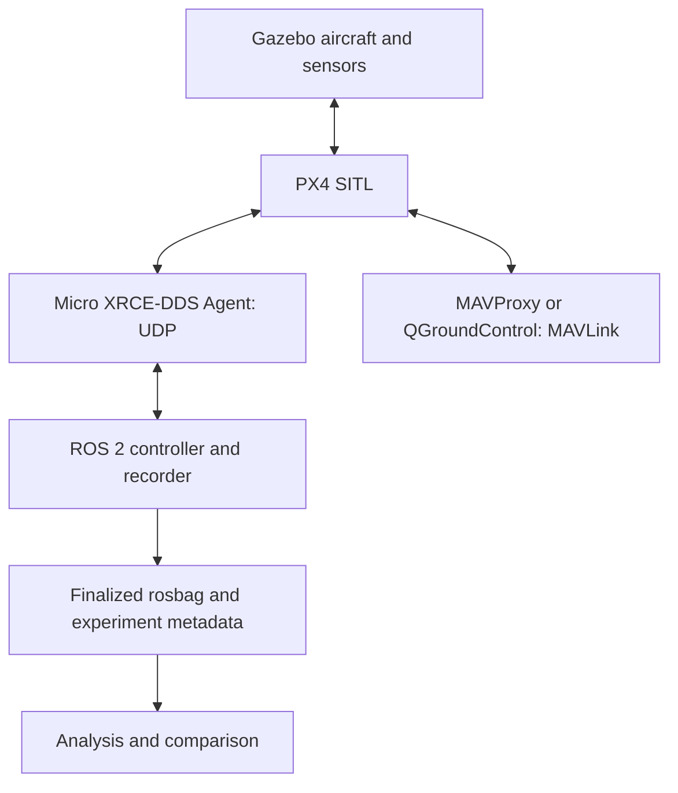
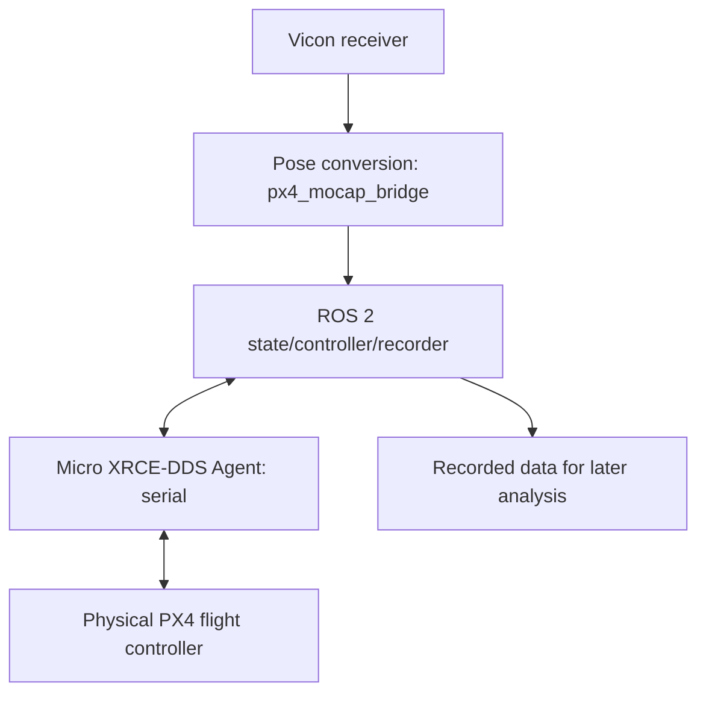

# Software structure

The toolkit keeps environment services, flight/controller nodes, and recorded-data analysis separate. Starting an environment prepares communication and simulation; it does not execute a controller experiment.

## How the parts connect

For physical flight, firmware runs on the aircraft instead of the workstation:

The current simulator estimator uses configured Gazebo/external-vision aiding plus IMU. The hardware bridge supplies pose; estimator configuration on the actual vehicle remains separate. Read the [environment guides](../environments/sitl.md) for process windows rather than treating these diagrams as launch commands.

## Where to find the code

| Read for | Entry point | Follow into |
|---|---|---|
| Install/pin dependencies | [setup/install.sh](https://github.com/ANCL/px4-dev-toolkit/blob/main/setup/install.sh) | `setup/fetch_sources.sh`, `config/sources/`, ROS/PX4 build helpers |
| Start services | [tools/sitl](https://github.com/ANCL/px4-dev-toolkit/blob/main/tools/sitl), [tools/hardware](https://github.com/ANCL/px4-dev-toolkit/blob/main/tools/hardware) | Runtime configuration, `tools/runtime/`, ROS service launches |
| Position-mode reference | [px4_position_mode](https://github.com/ANCL/px4-dev-toolkit/tree/main/ros2/src/px4_position_mode) | Launch, node, state, lifecycle, publication, joystick |
| External position reference | [offboard_position](https://github.com/ANCL/px4-dev-toolkit/tree/main/ros2/src/offboard_controllers/src/offboard_position) | Node, state, lifecycle, publication |
| Full SE(3) controller | [se3/node.cpp](https://github.com/ANCL/px4-dev-toolkit/blob/main/ros2/src/offboard_controllers/src/se3/node.cpp) | `runtime/`, pure `control/`, trajectories, rate/physical adapters |
| Record an experiment | [recording.py](https://github.com/ANCL/px4-dev-toolkit/blob/main/ros2/src/px4_control_common/px4_control_common/recording.py) | Package launch and selected topics |
| Run a study | [tools/run_sequence](https://github.com/ANCL/px4-dev-toolkit/blob/main/tools/run_sequence) | `tools/sequence/`, manifest and experiment metadata |
| Analyze/compare | [analysis](https://github.com/ANCL/px4-dev-toolkit/tree/main/analysis) | Bag loader, signal extraction/statistics, profiles, reporting/plots |

## ROS 2 packages

`px4_bringup` provides agent/GCS launchers. `px4_control_common` provides recording and the virtual-joystick client. `px4_position_mode` contains the reference flight and independent-Offboard staging examples. `offboard_controllers` contains position-reference/SE(3) nodes, analytic trajectories, vehicle loading, rate reproduction, and physical adaptation. `px4_mocap_bridge` combines Vicon launch with pose conversion.

Pure controller laws describe the calculation; runtime modules select modes, gather state, and publish PX4 messages. The central topic catalog connects C++ interfaces, recording selection, and Python analysis without independent lists of literal topic names.

## Source, runtime, and data

`config/` stores runtime, vehicle, sequence, source/version, and topic definitions. `docker/` provides SITL packaging. `px4/` and `ros2/` hold build helpers and source locations; external projects are reconstructed from pinned manifests rather than vendored as toolkit code.

Controllers/launches execute a run. Rosbag captures messages; manifests preserve experiment identity. `analysis/core.py` reads receive timestamps, `analysis/pipeline/` extracts common PX4 signals/statistics, and `analysis/profiles/` defines experiment-specific meaning. Analysis writes reports beside the data without modifying controller behavior.

Continue with [Configuration files](configuration.md).
