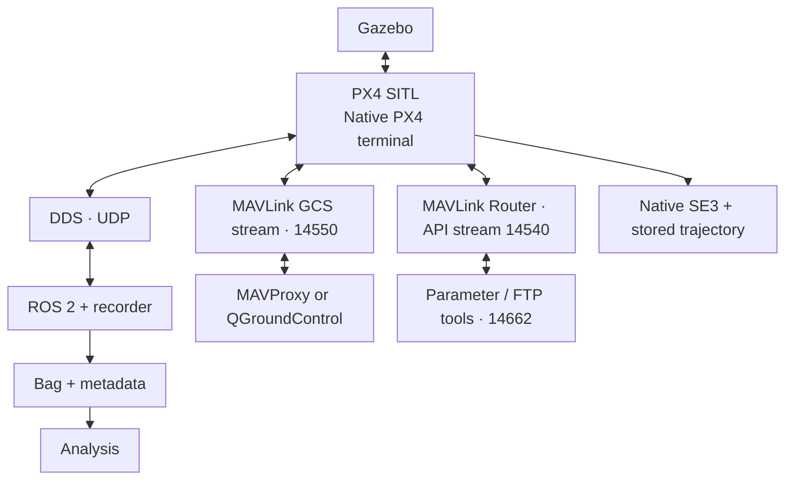
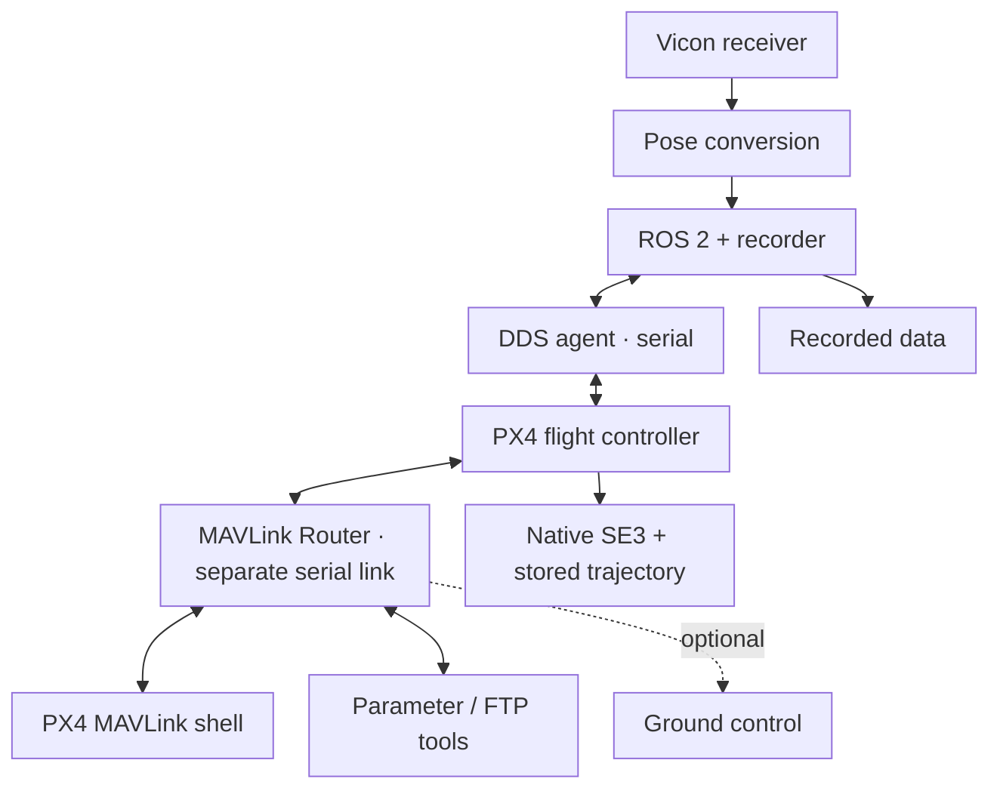

<!-- Preserve existing section links. -->

# Architecture

The toolkit separates environment services, controllers, trajectory transport, and flight-data analysis. This page maps each responsibility to its code.

<!-- Preserve existing section links. -->

## How the parts connect

For physical flight, firmware runs on the aircraft instead of the workstation:

In simulation, PX4 uses configured Gazebo/external-vision aiding and IMU. On hardware, the mocap bridge converts ENU/FLU pose to NED/FRD `VehicleOdometry`. MAVLink transfer and XRCE-DDS use separate links. See [SITL](../environments/sitl.md) and [Companion computer](../environments/hardware.md) for runtime setup.

<!-- Preserve existing section links. -->

## Where to find the code

| Read for | Entry point | Follow into |
|---|---|---|
| Installation | [setup/install.sh](https://github.com/ANCL/px4-dev-toolkit/blob/0b668261e04732ef97e2965dbe8f5c1ba56730f0/setup/install.sh) | Source pins and build scripts |
| Start services | [tools/sitl](https://github.com/ANCL/px4-dev-toolkit/blob/0b668261e04732ef97e2965dbe8f5c1ba56730f0/tools/sitl), [tools/hardware](https://github.com/ANCL/px4-dev-toolkit/blob/0b668261e04732ef97e2965dbe8f5c1ba56730f0/tools/hardware) | Runtime config and process helpers |
| Position-mode reference | [px4_position_mode](https://github.com/ANCL/px4-dev-toolkit/tree/0b668261e04732ef97e2965dbe8f5c1ba56730f0/ros2/src/px4_position_mode) | Launch, state and joystick |
| External position reference | [offboard_position](https://github.com/ANCL/px4-dev-toolkit/tree/0b668261e04732ef97e2965dbe8f5c1ba56730f0/ros2/src/offboard_controllers/src/offboard_position) | Node and control lifecycle |
| Shared trajectory mathematics | [`trajectory_generator/`](https://github.com/ANCL/px4-dev-toolkit/tree/0b668261e04732ef97e2965dbe8f5c1ba56730f0/trajectory_generator) | C++ sampler and YAML adapter |
| ROS 2 Offboard SE3 controller | [se3/node.cpp](https://github.com/ANCL/px4-dev-toolkit/blob/0b668261e04732ef97e2965dbe8f5c1ba56730f0/ros2/src/offboard_controllers/src/se3/node.cpp) | [`Se3::execute_handoff()`](https://github.com/ANCL/px4-dev-toolkit/blob/0b668261e04732ef97e2965dbe8f5c1ba56730f0/ros2/src/offboard_controllers/src/se3/runtime/control.cpp#L23), pure `control/`, trajectories |
| Native onboard control | [pinned PX4 SE3 runtime](https://github.com/ANCL/PX4-Autopilot/blob/5dd32eb1e7ab8b79b8ece462ce5f22cd75272c56/src/modules/se3_control/Runtime.cpp) | Mode registration, hold and rate output |
| Parameter / trajectory transfer | `tools/onboard_params`, `tools/trajectory`, `tools/transfer/` | MAVLink transfers and acknowledgements |
| Record an experiment | [recording.py](https://github.com/ANCL/px4-dev-toolkit/blob/0b668261e04732ef97e2965dbe8f5c1ba56730f0/ros2/src/px4_control_common/px4_control_common/recording.py) | [`launch_experiment()`](https://github.com/ANCL/px4-dev-toolkit/blob/0b668261e04732ef97e2965dbe8f5c1ba56730f0/ros2/src/px4_control_common/px4_control_common/recording.py#L150) and topic selection |
| Run a study | [tools/run_sequence](https://github.com/ANCL/px4-dev-toolkit/blob/0b668261e04732ef97e2965dbe8f5c1ba56730f0/tools/run_sequence) | [`load_sequence()`](https://github.com/ANCL/px4-dev-toolkit/blob/0b668261e04732ef97e2965dbe8f5c1ba56730f0/tools/sequence/config.py#L43), [`run_step()`](https://github.com/ANCL/px4-dev-toolkit/blob/0b668261e04732ef97e2965dbe8f5c1ba56730f0/tools/sequence/execution.py#L50), manifests |
| Analyze/compare | [analysis](https://github.com/ANCL/px4-dev-toolkit/tree/0b668261e04732ef97e2965dbe8f5c1ba56730f0/analysis) | Signals, profiles and plots |

<!-- Preserve existing section links. -->

## ROS 2 packages

`px4_bringup` provides agent/GCS launchers. `px4_control_common` provides recording and the virtual-joystick client. `px4_position_mode` contains the reference flight and independent-Offboard staging examples. `offboard_controllers` contains position-reference/SE(3) nodes, trajectory YAML loading, vehicle loading, and rate reproduction. `px4_mocap_bridge` combines Vicon launch with pose conversion.

The analytic core of `trajectory_generator/` owns reference sampling through snap without ROS or PX4 dependencies; its separate configuration layer reads YAML. Offboard nodes load shared YAML and start trajectory time at confirmed Offboard entry. For onboard use, the toolkit compiler writes a `.traj` plan, MAVLink FTP uploads it, and the firmware's `src/lib/trajectory/` samples it after an explicit request. Firmware mode selection first captures the actual pose for holding.

Native SE3 registers a Commander external-mode slot **inside PX4** and publishes body rates and normalized thrust at a nominal 100 Hz. PX4 retains rate control and allocation. Its implementation is described under [Onboard SE3](../controllers/onboard-se3.md); the ROS controller is described under [Offboard SE3](../controllers/se3.md).

<!-- Preserve existing section links. -->

## Source, runtime, and data

`config/` stores runtime, vehicle, sequence, source/version, and topic definitions. `docker/` provides SITL packaging. `px4/` and `ros2/` hold build helpers and source locations; external projects are reconstructed from pinned manifests rather than vendored as toolkit code.

Controllers/launches execute a run. `tools/px4_record` can independently record DDS telemetry for onboard experiments. Rosbag captures received ROS messages; PX4 ULog captures firmware logging and is a separate artifact with a separate analysis path. Manifests preserve experiment identity. `analysis/core.py` reads receive timestamps, `analysis/pipeline/` extracts common PX4 signals/statistics, and `analysis/profiles/` defines experiment-specific meaning. Analysis writes reports beside the data without modifying controller behavior.

See [Configuration](configuration.md) for the settings owned by each component.

## Validation scope

The toolkit separates an implemented interface from a configuration that has been exercised in flight:

| Environment | Confirmed evidence | Still requires verification |
|---|---|---|
| Native SITL (`gz_f450`) | Onboard SE3 selected, held position, and executed `full_excitation` successfully | Different aircraft, trajectories, and controller configurations |
| Docker SITL | SITL image built and its packaged tools passed command/dependency checks | Complete live Docker simulation and controller-flight sequence |
| Physical companion / PX4 | Native module, shell and transfer paths are implemented | Actual aircraft tuning, state estimation, control handoff, recovery procedures, and physical flight |

Physical flight requires the [hardware](../environments/hardware.md) and [onboard](../operations/onboard.md) preparation procedures.
