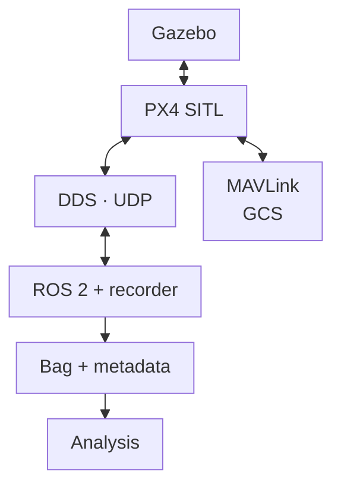
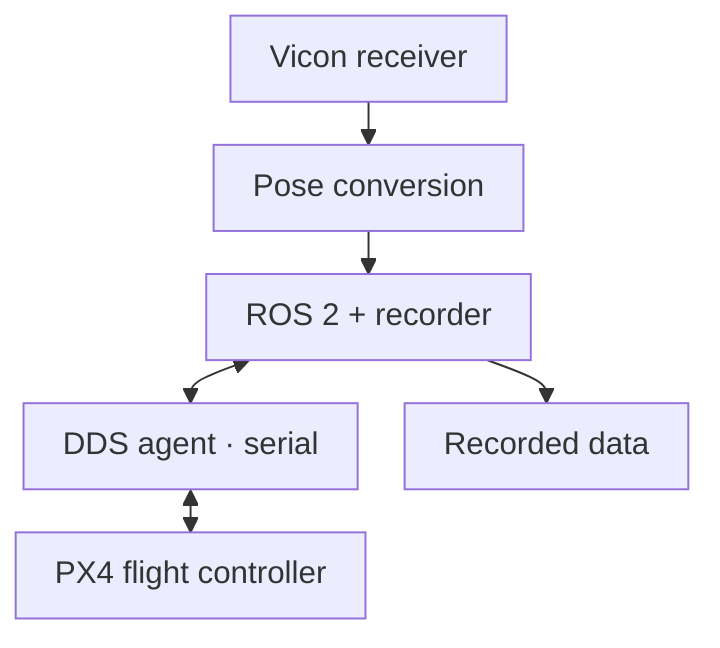

<!-- Preserve existing section links. -->

# Architecture

The toolkit keeps environment services, flight/controller nodes, and recorded-data analysis separate. Starting an environment prepares communication and simulation; it does not execute a controller experiment.

<!-- Preserve existing section links. -->

## How the parts connect

For physical flight, firmware runs on the aircraft instead of the workstation:

The current simulator estimator uses configured Gazebo/external-vision aiding plus IMU. The hardware bridge supplies pose; estimator configuration on the actual vehicle remains separate. Read the [environment guides](../environments/sitl.md) for process windows rather than treating these diagrams as launch commands.

<!-- Preserve existing section links. -->

## Where to find the code

| Read for | Entry point | Follow into |
|---|---|---|
| Install/pin dependencies | [setup/install.sh](https://github.com/ANCL/px4-dev-toolkit/blob/main/setup/install.sh) | `setup/fetch_sources.sh`, `config/sources/`, ROS/PX4 build helpers |
| Start services | [tools/sitl](https://github.com/ANCL/px4-dev-toolkit/blob/main/tools/sitl), [tools/hardware](https://github.com/ANCL/px4-dev-toolkit/blob/main/tools/hardware) | Runtime configuration, `tools/runtime/`, ROS service launches |
| Position-mode reference | [px4_position_mode](https://github.com/ANCL/px4-dev-toolkit/tree/main/ros2/src/px4_position_mode) | Launch, node, state, lifecycle, publication, joystick |
| External position reference | [offboard_position](https://github.com/ANCL/px4-dev-toolkit/tree/main/ros2/src/offboard_controllers/src/offboard_position) | Node, state, lifecycle, publication |
| Shared trajectory mathematics | [`trajectory/`](https://github.com/ANCL/px4-dev-toolkit/tree/main/trajectory_generator) | Pure C++ sampler, independent of ROS, YAML, and PX4 |
| Full SE(3) controller | [se3/node.cpp](https://github.com/ANCL/px4-dev-toolkit/blob/main/ros2/src/offboard_controllers/src/se3/node.cpp) | [`Se3::execute_handoff()`](https://github.com/ANCL/px4-dev-toolkit/blob/main/ros2/src/offboard_controllers/src/se3/runtime/control.cpp#L23), pure `control/`, trajectories, adapters |
| Record an experiment | [recording.py](https://github.com/ANCL/px4-dev-toolkit/blob/main/ros2/src/px4_control_common/px4_control_common/recording.py) | [`launch_experiment()`](https://github.com/ANCL/px4-dev-toolkit/blob/main/ros2/src/px4_control_common/px4_control_common/recording.py#L69) and topic selection |
| Run a study | [tools/run_sequence](https://github.com/ANCL/px4-dev-toolkit/blob/main/tools/run_sequence) | [`load_sequence()`](https://github.com/ANCL/px4-dev-toolkit/blob/main/tools/sequence/config.py#L43), [`run_step()`](https://github.com/ANCL/px4-dev-toolkit/blob/main/tools/sequence/execution.py#L50), manifests |
| Analyze/compare | [analysis](https://github.com/ANCL/px4-dev-toolkit/tree/main/analysis) | Bag loader, signal extraction/statistics, profiles, reporting/plots |

<!-- Preserve existing section links. -->

## ROS 2 packages

`px4_bringup` provides agent/GCS launchers. `px4_control_common` provides recording and the virtual-joystick client. `px4_position_mode` contains the reference flight and independent-Offboard staging examples. `offboard_controllers` contains position-reference/SE(3) nodes, trajectory YAML loading, vehicle loading, rate reproduction, and physical adaptation. `px4_mocap_bridge` combines Vicon launch with pose conversion.

The toolkit-level `trajectory_generator/` C++ library owns analytic sampling through snap without ROS, YAML, or PX4 dependencies. Existing Offboard nodes continue loading trajectory YAML through the ROS package and starting trajectory time at confirmed Offboard entry. The current SE(3) controller implements conventional underactuated multirotor reference geometry; the four-rotor physical adapter remains unchanged. Future onboard PX4 modules will require their own runtime and an embedded-compatible trajectory integration.

Pure controller laws describe the calculation; runtime modules select modes, gather state, and publish PX4 messages. The central topic catalog connects C++ interfaces, recording selection, and Python analysis without independent lists of literal topic names.

<!-- Preserve existing section links. -->

## Source, runtime, and data

`config/` stores runtime, vehicle, sequence, source/version, and topic definitions. `docker/` provides SITL packaging. `px4/` and `ros2/` hold build helpers and source locations; external projects are reconstructed from pinned manifests rather than vendored as toolkit code.

Controllers/launches execute a run. Rosbag captures messages; manifests preserve experiment identity. `analysis/core.py` reads receive timestamps, `analysis/pipeline/` extracts common PX4 signals/statistics, and `analysis/profiles/` defines experiment-specific meaning. Analysis writes reports beside the data without modifying controller behavior.

See [Configuration](configuration.md) for the settings owned by each component.
