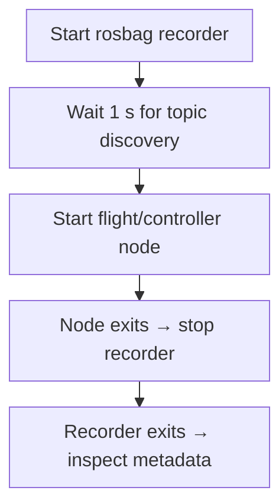

<!-- Preserve existing section links. -->
<span id="recording-experiments"></span>

# Recording

Recording captures a flight's messages, not just its final controller result. Add `record:=true` to the supported launch to start a recorder before the node and stop it after node exit.

## Lifecycle



[px4_control_common.recording](https://github.com/ANCL/px4-dev-toolkit/blob/main/ros2/src/px4_control_common/px4_control_common/recording.py) delays node startup by one second **after recorder process start**. This is a discovery allowance, not a guarantee that every topic has been discovered. Early recorder exit or nonzero node exit fails the launch. Recorder shutdown follows node exit; node completion alone does not prove the bag was finalized.

## Record a native Position-mode run

With a ready, initially landed/disarmed **SITL** vehicle and MAVProxy, in a **second repository-root shell**:

```bash
source ros2/runtime_env.sh
ros2 launch px4_position_mode position_takeoff_hover.launch.py record:=true
```

This produces `bags/position_takeoff_hover/<timestamp>/`. For the separate airborne staging demonstration, the equivalent launch is `offboard_takeoff_handoff.launch.py` and the bag family is `offboard_takeoff_handoff`. Do not run those demonstrations concurrently.

<!-- Preserve existing section links. -->
<span id="record-offboard-position"></span>
<span id="record-se3"></span>

## Record Offboard position or SE(3)

After preparing the aircraft for the chosen controller, use **one** launch in a **separate repository-root shell**. Offboard position:

```bash
source ros2/runtime_env.sh
ros2 launch offboard_controllers offboard_position.launch.py \
  trajectory:=line_tracking record:=true
```

SE(3), as a separate experiment:

```bash
source ros2/runtime_env.sh
ros2 launch offboard_controllers se3.launch.py \
  vehicle:=gz_f450 trajectory:=full_excitation handoff:=acceleration \
  publish_diagnostics:=true record:=true
```

They create `bags/offboard_position/<timestamp>/` and `bags/se3/<timestamp>/` respectively. SE(3) additionally supports `recording_output` for an explicit **new** directory; the study runner uses that argument for deterministic paths. Existing output paths are rejected rather than overwritten.

<!-- Preserve existing section links. -->
<span id="topic-ownership"></span>
<span id="se3-recording-scope"></span>

## Topic selection

PX4 topic names are symbolic entries in [config/px4_topics.def](https://github.com/ANCL/px4-dev-toolkit/blob/main/config/px4_topics.def). Package [recording lists](https://github.com/ANCL/px4-dev-toolkit/tree/main/ros2/src/offboard_controllers/config/recording) select those symbols. SE(3) recording also permits absolute toolkit diagnostic topic names.

The SE(3) list captures state/status, estimator/failsafe context, heartbeat, handoff setpoints, downstream PX4 setpoints, allocation/motors, and the generated trajectory. Diagnostics need `publish_diagnostics:=true` to produce samples; listing a topic does not cause a publisher to run.

<!-- Preserve existing section links. -->
<span id="finalization-contract"></span>
<span id="analyze-a-bag"></span>

## Finalization and inspection

Example directory structure (storage files depend on the installed rosbag backend):

```{ .text .no-copy }
bags/se3/<timestamp>/
├── metadata.yaml
├── <rosbag storage files>
└── analysis/                 # created later by px4_analyze
```

The sequence runner checks for `metadata.yaml` before advertising a bag as finalized. It writes `experiment.json` inside finalized study bags with the profile, step, and effective launch arguments. Standalone launches do not write this experiment identity file; retain the launch arguments yourself. Direct-controller identity may otherwise be `unknown` in analysis.

In a **repository-root shell with ROS sourced**, find the most recent finalized standalone SE(3) bag and inspect it:

```bash
bag_path="$(find bags/se3 -mindepth 2 -maxdepth 2 -name metadata.yaml -printf '%h\n' | sort | tail -n 1)"
test -n "$bag_path" && ros2 bag info "$bag_path"
```

Confirm topic names/counts, duration, readable storage, and expected early/late messages. Metadata presence is necessary for the runner, but does not prove the experiment succeeded or every required signal exists.

<!-- Preserve existing section links. -->
<span id="next"></span>

## Interrupted recording

Allow the recorder to exit cleanly after an interruption. Preserve the bag and logs; do not immediately delete or rename storage files. If metadata is missing, first check the recorder is no longer writing. ROS supports reindexing some storage formats, but recoverability depends on backend and installed plugins. Inspect the recovered bag before analysis; a reindexed file cannot recreate messages never recorded.

Continue with [Analyzing one run](../analysis/analysis.md).
